# 底盘采购标准作业程序（SOP）

> **文档性质**：内部作业指导书  
> **适用范围**：底盘询价、预算、中标后技术确认、SAP下单、订单确认、交期管控、到货入库、质量放行及资料归档  
> **适用对象**：底盘采购、项目管理、技术、计划、物流、质量、财务及相关支持岗位  
> **版本**：V1.0  
> **原则**：全过程留痕、技术配置一致、价格可追溯、交期受控、审批完整、文件归档统一

---

## 1. 目的与核心控制原则

本SOP用于建立可审计、可追踪、可交接的底盘采购流程，确保：

1. 询价依据完整，供应商报价与技术规格书、招标清单一致。
2. 中标后采购配置与最终技术检查结果一致。
3. SAP采购订单中的供应商、价格、税码、交期、项目归集及文本准确。
4. 底盘交付时间与项目SOP保持合理匹配。
5. 订单确认、配置变更、交期调整、到货和质量异常均形成书面记录。
6. 关键邮件、报价、订单文件、签字文件、订单确认及交货单均归档至项目目录和SAP。
7. 底盘在到货后至整车制造结束期间持续满足适用的注册及GSR合规要求。

### 1.1 全流程总览

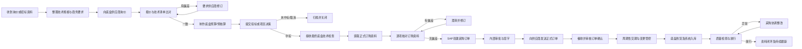

---

## 2. 角色与职责

| 角色 | 主要职责 | 关键输出 |
|---|---|---|
| 底盘采购 | 询价、商务比较、SAP下单、订单确认审核、交期管理、异常协调、归档 | 询价邮件、报价比较、采购订单、交期记录 |
| 投标/报价管理 | 提供招标文件、客户要求及报价期限；接收采购预算 | 招标资料、需求清单、预算反馈 |
| 底盘技术/工程 | 编制底盘规格书、禁用代码、必选代码及技术边界 | 技术规格书、配置说明 |
| 最终技术检查岗位 | 中标后按客户订单、报价和工程要求形成最终检查结果 | 最终底盘检查文件 |
| 项目经理 | 确认项目配置、交期、变更及项目风险 | 项目确认、变更决定 |
| 生产计划 | 维护SOP及排产信息，协调项目时间 | 最新SOP、排产计划 |
| 物流 | 到货通知、收货、入库及交货单传递 | 到货邮件、收货凭证 |
| 质量 | 到货配置检查、缺陷记录、放行或拒绝放行 | 检验结果、异常清单 |
| 财务 | 发票、付款条件及付款流程协同 | 发票审批、付款记录 |
| 审批人 | 审核采购订单的技术、价格和商业合理性 | 签字文件、SAP审批 |
| 供应商 | 提交报价、订购资料、订单确认、交付和注册文件 | 报价、订购资料、AB、交付资料 |

### 2.1 协同责任流

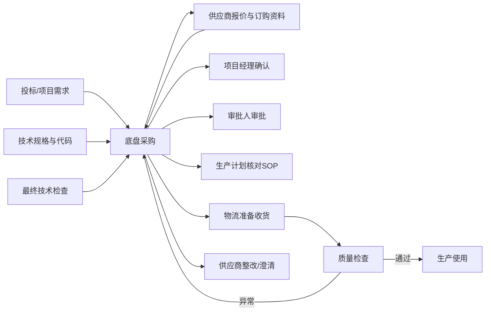

---

## 3. 第一阶段：询价、报价核对与底盘预算

### 3.1 输入资料

采购收到询价任务后，至少应确认以下资料是否齐全：

- 招标文件或采购需求文件；
- 性能说明、技术服务清单或技术需求清单；
- 底盘技术规格书；
- 禁用代码清单；
- 必选代码清单；
- 项目名称、车辆类型、客户/地点、项目号；
- 报价截止日期；
- 目标交期、SOP或阶段性里程碑；
- 供应商联系人；
- 是否要求GSR或其他注册法规合规；
- 是否包含绞盘、首次参数化、第三方改装等附加项目。

### 3.2 询价作业

1. 新建项目询价目录，建议命名：  
   `[车辆类型] [项目地点] A [项目号] P [PSP主编号] [供应商简称]`
2. 将内部询价任务邮件、招标资料、技术规格书及附件存入目录。
3. 向供应商发送完整询价资料，同时抄送内部需求方。
4. 邮件中明确：
   - 需要依据技术规格书报价；
   - 禁用代码不得包含；
   - 必选代码必须包含；
   - 报价必须与填写后的需求清单一致；
   - 车辆需满足适用的GSR要求；
   - 报价截止日期；
   - 交期定义是“从收到订单起”还是“固定到货日期”；
   - 报价是否包含首次参数化、运输、改装或其他一次性费用。
5. 发送后将外发邮件保存到项目询价目录。
6. 截止日前未收到报价时，立即书面催办并记录催办日期。

### 3.3 询价流程

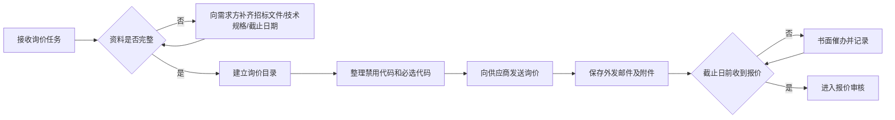

### 3.4 报价审核

收到报价后，不得只核对总价。应逐项检查：

- 车辆型号、轴型、驱动形式、轴距、总质量和发动机参数；
- 必选代码是否全部包含；
- 禁用代码是否被排除；
- 技术规格书的关键功能是否覆盖；
- 数量、单价、折扣、附加费和净价；
- 首次参数化费用是否单列；
- 运输费用和交付地点；
- 付款条件；
- 报价有效期；
- 交货期的起算点；
- GSR及注册合规表述；
- 供应商保留条款、价格调整条款和不可控交期条款；
- 是否存在供应商额外推荐选项。

### 3.5 报价偏差处理

若发现偏差，应按“新增、删除、修改”分类书面反馈：

- **新增**：报价中缺少但技术要求必须包含的项目；
- **删除**：报价中不允许或不需要的配置；
- **修改**：代码、数量、价格、交期或技术说明错误；
- **待确认**：不能由采购单独判断，需技术或项目负责人决定的内容。

供应商提交修订版后，应重新执行完整核对，不得只检查被指出的项目。

### 3.6 报价审核流程

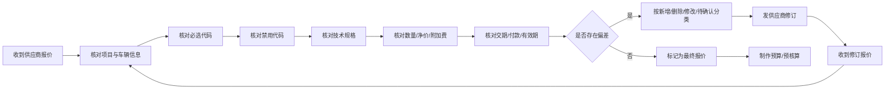

### 3.7 预算及预核算

在预算模板的底盘页中录入：

- 供应商；
- 车型/型号；
- 描述；
- 数量；
- 单台采购净价；
- 附加费用；
- 交货期；
- 报价有效期；
- 备注及额外选项；
- 价格口径说明。

首次参数化或一次性工程费必须单独识别，不得隐藏在单价中。完成后，将以下文件一并发给投标或需求负责人：

1. 已完成的预核算模板；
2. 最终供应商报价；
3. 已填写的需求清单；
4. 技术规格书；
5. 关键澄清邮件；
6. 风险及假设说明。

项目未中标或取消时，将目录移入已关闭区域，并保留关闭原因及日期。

---

## 4. 第二阶段：中标后正式采购准备

### 4.1 建立采购项目目录

中标后收到最终底盘技术检查文件，应建立正式采购目录。目录至少包含：

1. `01_最终技术检查`
2. `02_最终供应商报价`
3. `03_预核算`
4. `04_订购资料`
5. `05_内部澄清`
6. `06_供应商澄清`
7. `07_签字订单`
8. `08_订单确认_AB`
9. `09_交期与变更`
10. `10_到货与质量`
11. `11_注册文件`

### 4.2 索取正式订购资料

向供应商发送最终技术检查文件，并说明：

- 项目及车辆信息；
- 期望到货日期；
- 交付地址；
- 请依据最终技术检查文件生成正式订购资料；
- 底盘自到货时起，在整车制造全过程中必须持续满足注册及GSR合规要求；
- 若为寄售、客户提供或第三方交付，应明确责任边界；
- 若需先送往绞盘或改装供应商，应明确第一交付地址及后续运输责任。

### 4.3 正式订购资料审核

对照以下三个基准逐项核对：

- 最终底盘技术检查文件；
- 已审核的最终报价；
- 项目当前有效需求。

重点检查：

- 车型和底盘基本参数；
- 所有技术代码；
- 配置描述；
- 数量；
- 采购净价；
- 一次性费用；
- 交付日期；
- 交付地址；
- 付款条件；
- 注册/GSR要求；
- 变更截止日期；
- 供应商订单条款。

### 4.4 正式采购准备流程

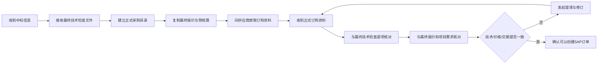

---

## 5. 第三阶段：SAP创建采购订单

### 5.1 下单前检查清单

创建采购订单前，应确认：

- BANF采购申请号及项目位置；
- PSP元素；
- 供应商及正确分支机构；
- 采购组织、采购组和工厂；
- 底盘物料号；
- 数量和计量单位；
- 净价及价格单位；
- 税码；
- 到货日期；
- 交付地址；
- 付款条件；
- 项目SOP；
- 最终报价、正式订购资料和技术检查均已完成；
- 是否存在绞盘、第三方改装或特殊运输。

### 5.2 关键SAP事务码

| 事务码 | 用途 |
|---|---|
| CJ20N | 查找项目、PSP元素、BANF及项目结构信息 |
| ME21N | 创建采购订单 |
| ME23N | 显示及复核采购订单、上传附件 |
| VA03 | 查询客户订单及底盘销售价格 |
| CV01N | 创建并关联项目文档 |
| ME57 | 检查和分配采购申请 |
| MM03 | 查询物料主数据及变更信息 |
| MM01 | 按授权创建或扩展物料视图/分类信息 |

### 5.3 订单创建步骤

1. 在CJ20N中输入PSP元素，查找对应BANF号和位置号。
2. 使用后及时退出CJ20N，避免项目被锁定。
3. 进入ME21N，引用BANF号及位置号创建订单。
4. 选择正确供应商和正确分支机构，依据联系人地址、报价主体和税务主体验证。
5. 核对采购组、采购组织、工厂和采购订单类型。
6. 输入正式订购资料中的净价。
7. 核对数量、价格单位、税码和币种。
8. 根据当前规则设置到货日期。标准原则为到货早于项目SOP 14天；若项目或供应商另有确认，以批准后的日期为准。
9. 必要时更改交付地址，例如先送往绞盘安装商或第三方改装方。
10. 填写外部可见的抬头文本。
11. 填写内部头部备注。
12. 维护短文本和位置文本。
13. 检查科目分配和PSP元素。
14. 保存前执行完整检查。
15. 保存后，系统自动邮件仅发送至内部邮箱，不得直接替代正式供应商订单邮件。
16. 退出ME21N，进入ME23N重新复核订单。
17. 上传所有相关依据文件。

### 5.4 订单文本标准

#### 外部抬头文本应包含

- 车辆类型/项目地点；
- 项目号；
- PSP主编号；
- 订单确认发送要求；
- 必要的合规要求；
- 交付地点或特别说明。

#### 内部头部备注格式

```text
Offer: [报价金额] EUR / Order: [订单金额] EUR / Sale: [销售金额] EUR
SOP: [日期]
Delivery date: [日期]
SOP will be adjusted as soon as the delivery date is confirmed
Payment term: 30 days after delivery chassis
```

#### 短文本格式

```text
[项目地点] / [项目号] / [PSP主编号]
```

### 5.5 价格交叉检查

- **Offer**：最终报价或预核算中的价格；
- **Order**：正式订购资料及SAP订单价格；
- **Sale**：客户订单中底盘销售价格；
- 若销售价低于采购价或差异异常，必须暂停并向项目负责人确认；
- 不得通过修改备注掩盖价格差异；
- 所有价格差异应有书面批准或解释。

### 5.6 SAP下单流程

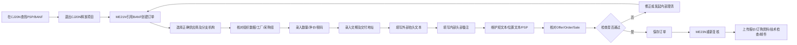

---

## 6. 第四阶段：订单审批、签字与对外发送

### 6.1 纸质或电子签字资料

签字包至少包含：

- 最终订购资料；
- SAP采购订单；
- 项目信息纸条；
- 必要的变更说明；
- 价格比较或异常批准。

项目信息纸条至少列出：

- 项目；
- 项目号；
- 车辆品牌/项目地点；
- 采购订单号；
- 报价金额；
- 订单金额；
- 销售金额；
- 订单变更；
- SOP；
- 到货日期；
- 付款条件。

### 6.2 审批与签字

1. 将签字包提交给授权审批人。
2. 等待SAP审批完成。
3. 审批前不得向供应商发送具有法律约束力的正式订单。
4. 审批完成后扫描或保存签字版本。
5. 将签字版本和SAP订单文件归档至项目目录并上传SAP。

### 6.3 向供应商发送正式订单

正式邮件至少包含：

- 已签字订购资料；
- SAP采购订单；
- 车辆、项目和订单号；
- 预计到货日期；
- 交付地址；
- 要求供应商进行生产排期；
- 要求供应商发送订单确认至指定公共邮箱；
- GSR及持续注册合规要求。

### 6.4 审批及发送流程

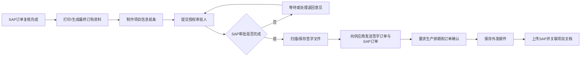

---

## 7. 第五阶段：订单确认（AB）催收与审核

### 7.1 催收要求

- 订单发出后应立即记录发送日期。
- 在内部规定时间内未收到订单确认，应主动催收。
- 催收应使用书面方式并保留邮件。
- 供应商口头承诺必须通过邮件确认。

### 7.2 订单确认审核项目

收到AB后，检查：

- 本单位采购订单号；
- 供应商订单号；
- 车辆/项目；
- 型号及技术代码；
- 数量；
- 净价、附加费和币种；
- 付款条件；
- 确认交期；
- 交付地址；
- 供应商短号、PIN或生产识别码；
- 变更截止日期；
- GSR及注册状态；
- 供应商一般条款是否引入新风险。

### 7.3 偏差处理

- 无偏差：标记为“已审核，无偏差”，上传SAP并更新总表。
- 有偏差：不得直接接受。建立差异清单，发供应商澄清。
- 价格偏差：核对是否为涨价、附加费、折扣遗漏或报价有效期问题。
- 交期偏差：评估对SOP、生产排期和第三方改装的影响。
- 配置偏差：由技术/项目负责人确认，采购负责闭环。
- 所有澄清邮件均需上传SAP。

### 7.4 AB审核流程

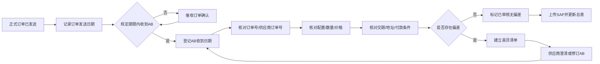

---

## 8. 第六阶段：底盘交期和变更管控

### 8.1 必要数据

底盘交期管控至少需要：

- 最新项目SOP；
- 当前供应商确认交期；
- 订单原始交期；
- 变更截止日期；
- 底盘状态；
- 是否已在库；
- 是否在第三方改装商处；
- 已采取的行动；
- 责任人；
- 下次跟进日期。

### 8.2 周度操作

1. 每周五上午更新SOP。
2. 将最新SOP导入底盘总表。
3. 筛选已下单且尚未最终到货的底盘。
4. 排除已在本单位仓库或已在指定第三方仓库的底盘。
5. 重点监管未来一个季度内相关底盘。
6. 比较SOP与当前交期。
7. 检查变更截止日期。
8. 对需要提前、推迟或澄清的底盘立即采取行动。
9. 在总表行动栏记录日期、措施、供应商答复和下一步。
10. 对高风险项目同步项目经理和生产计划。

### 8.3 日期差异规则

统一采用：

```text
差异天数 = SOP日期 - 当前预计到货日期
```

- 正数：底盘早于SOP到货；
- 负数：底盘晚于SOP到货；
- 示例：SOP为6月30日，到货为6月10日，差异为+20天；
- 示例：SOP为6月30日，到货为7月10日，差异为-10天。

当前管控建议：

- `0至+30天`：通常可接受，但仍需观察仓储容量和资金占用；
- `+30天以上`：存在过早到货、仓储和资金占用风险，应评估是否推迟；
- `0至-14天`：已晚于SOP，应确认生产是否可吸收；
- `-14天以下`：严重晚交风险，应升级跟踪；
- 临近变更截止日期：无论差异大小，都必须优先关闭技术变更。

### 8.4 风险分级

| 等级 | 典型条件 | 处理要求 |
|---|---|---|
| 绿色 | 交期与SOP匹配，配置冻结，AB完整 | 周度监控 |
| 黄色 | 交期偏差临近阈值，变更截止日期接近 | 书面确认，设置下一跟进日 |
| 橙色 | 过早超过30天或晚交超过14天，供应商交期不稳定 | 通知项目经理和计划，形成纠正措施 |
| 红色 | 已影响SOP、供应商无法确认交期、配置可能不合规 | 立即升级管理层并制定替代方案 |

### 8.5 交期管控流程

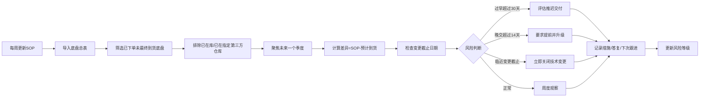

---

## 9. 第七阶段：配置变更管理

底盘下单后，客户或项目可能提出配置变更。任何变更均不得仅通过口头或聊天确认。

### 9.1 变更必要信息

- 项目和订单号；
- 当前配置；
- 请求变更内容；
- 变更原因；
- 供应商是否可实施；
- 变更费用；
- 对交期的影响；
- 对GSR、注册及整车技术的影响；
- 变更截止日期；
- 项目负责人和技术负责人的批准。

### 9.2 变更流程

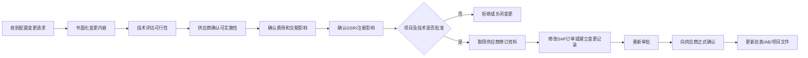

---

## 10. 第八阶段：底盘到货、入库及质量放行

### 10.1 到货后总表更新

收到物流到货通知后，应：

- 根据供应商订单号、项目号或底盘识别信息确认对应项目；
- 将状态改为“已到库”；
- 记录实际到货日期；
- 更新最后修改周次；
- 录入底盘识别号/VIN；
- 保存交货单PDF；
- 核对交付地点是否正确；
- 通知相关责任人。

### 10.2 SAP及主数据维护

按权限和内部规则：

1. 使用MM03查询底盘物料号及变更信息。
2. 根据需要使用MM01创建或扩展分类视图。
3. 维护底盘识别号、供应商订单号、项目归属、客户/自有属性、程序号等信息。
4. 项目程序号应从项目系统中查询，不得凭记忆填写。
5. 保存前进行双人或交叉检查。

### 10.3 质量检查与放行

质量部门检查底盘是否符合：

- 最终订购配置；
- AB确认配置；
- 法规与注册要求；
- 外观及运输状态；
- 随车文件完整性；
- 底盘识别号一致性。

若质量不放行，采购必须：

1. 获取明确的不放行原因；
2. 区分配置缺失、错误配置、运输损伤、文件缺失或系统数据问题；
3. 收集照片、检查报告和技术依据；
4. 向供应商发出书面异常通知；
5. 明确临时措施、整改责任、完成日期和费用承担；
6. 协调项目、技术、物流和质量；
7. 直至质量正式放行为止。

### 10.4 到货及放行流程

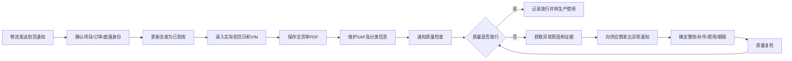

---

## 11. 第九阶段：注册文件管理

收到车辆注册证明或其他注册文件后：

1. 在底盘总表中登记收到日期和状态。
2. 核对VIN、车辆型号、供应商和项目归属。
3. 扫描或保存电子副本。
4. 将原件放入授权部门指定位置。
5. 通过邮件通知负责注册的岗位。
6. 邮件和扫描件归档至项目目录及SAP。
7. 若文件信息不一致，立即冻结流转并联系供应商修正。

### 11.1 注册文件流程

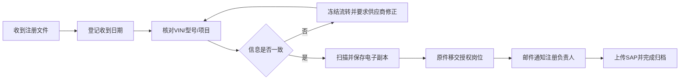

---

## 12. 日常、周度和月度工作节奏

### 12.1 每日任务

- 检查供应商、项目和内部邮件；
- 更新底盘总表；
- 审核待处理发票；
- 检查是否存在可下单项目；
- 使用ME57检查待分配采购申请；
- 跟进未收到的报价、订购资料和AB；
- 处理质量不放行或交期异常；
- 每日结束前保存底盘总表备份。

### 12.2 每周任务

- 周中更新需新下单项目清单；
- 每周五更新SOP；
- 重新计算SOP与交期差异；
- 复查未来一个季度的底盘；
- 审查临近变更截止日期的项目；
- 更新风险等级、行动、责任人和下次跟进日期；
- 向项目和计划岗位汇报橙色、红色风险。

### 12.3 每月任务

- 统计新下单、未回AB、延期、提前到货和质量异常数量；
- 检查未关闭的配置变更；
- 检查项目目录与SAP附件完整性；
- 检查长期未结采购订单；
- 总结供应商交付表现；
- 对重复异常制定供应商改进措施。

### 12.4 工作节奏流程

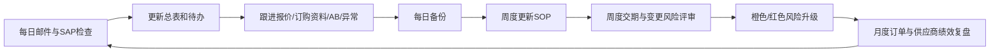

---

## 13. 文件归档与审计要求

### 13.1 必须归档的文件

- 内部询价任务；
- 招标文件、需求清单和技术规格书；
- 原始报价及所有修订报价；
- 报价澄清邮件；
- 预核算；
- 最终技术检查文件；
- 正式订购资料；
- SAP采购订单；
- 签字订单；
- 供应商订单确认；
- 配置变更及批准；
- 交期确认和催办邮件；
- 交货单；
- 质量报告和异常处理；
- 注册文件；
- 关键内部决定。

### 13.2 归档原则

- 文件名包含日期、项目、文件类型和版本；
- 最终版与草稿分开；
- 邮件以可追溯格式保存；
- SAP附件与项目目录保持一致；
- 不覆盖历史版本；
- 作废文件标记“作废”，不得直接删除；
- 关键决定必须能追溯到批准人和日期。

### 13.3 归档流程

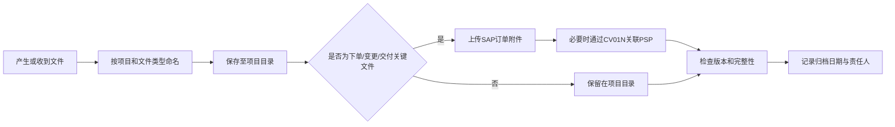

---

## 14. 关键质量门（Quality Gates）

| 质量门 | 放行条件 | 不满足时处理 |
|---|---|---|
| QG1 询价放行 | 资料完整、供应商和截止日期明确 | 补齐资料后再询价 |
| QG2 报价放行 | 技术、代码、价格、交期一致 | 要求修订报价 |
| QG3 下单放行 | 最终技术检查、订购资料、价格、PSP完整 | 暂停创建订单 |
| QG4 审批放行 | SAP订单复核、签字和审批完成 | 不得对外发送正式订单 |
| QG5 AB放行 | AB与订单无偏差或偏差已批准 | 要求修订AB |
| QG6 到货放行 | VIN、配置、文件和外观检查通过 | 启动异常整改 |
| QG7 结案放行 | 所有资料归档、风险关闭、状态更新 | 保持项目待办状态 |

### 14.1 质量门流程

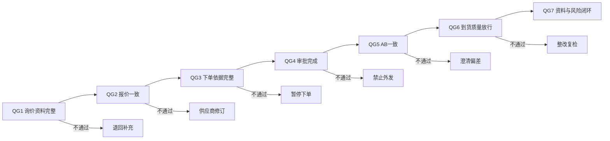

---

## 15. 风险与常见错误

| 风险/错误 | 后果 | 预防措施 |
|---|---|---|
| 仅核对报价总价 | 配置缺失或错误 | 逐项核对代码和技术规格 |
| 供应商分支机构选错 | 税务、交付和订单主体错误 | 按报价主体及联系人地址确认 |
| BANF或PSP错误 | 成本归集错误 | CJ20N核对并在ME23N复核 |
| 交期未与SOP比较 | 过早占资或晚交停产 | 使用统一差异公式周度检查 |
| AB未审核即归档 | 价格、配置或交期偏差被默认接受 | 建立AB审核清单 |
| 变更只通过口头确认 | 无法追责、供应商不执行 | 书面变更并重新审批 |
| 自动系统邮件直接发供应商 | 可能发送未批准内容 | 自动邮件仅内部发送 |
| 关键文件只存在个人邮箱 | 交接困难、审计缺失 | 项目目录和SAP双重归档 |
| 到货后未及时录入VIN | 项目和底盘无法准确匹配 | 到货当天完成总表和SAP更新 |
| GSR合规表述不完整 | 后续注册风险 | 询价、下单、AB三个阶段重复确认 |

---

## 16. 标准检查清单

### 16.1 下单前

- [ ] 最终技术检查已收到
- [ ] 最终供应商报价已确认
- [ ] 正式订购资料已核对
- [ ] 必选代码全部包含
- [ ] 禁用代码全部排除
- [ ] 净价及附加费正确
- [ ] 供应商及分支机构正确
- [ ] BANF和PSP正确
- [ ] 到货日期与SOP匹配
- [ ] 交付地址正确
- [ ] 付款条件正确
- [ ] GSR及注册要求已写入
- [ ] 必要内部批准已取得

### 16.2 发送订单前

- [ ] SAP订单已复核
- [ ] 审批已完成
- [ ] 签字文件已生成
- [ ] SAP订单已附入邮件
- [ ] 项目、订单号、到货日期正确
- [ ] 要求供应商发送AB
- [ ] 要求供应商进行生产排期
- [ ] 公共订单确认邮箱已列明
- [ ] GSR持续合规句已包含
- [ ] 外发邮件已保存并上传SAP

### 16.3 AB审核

- [ ] 采购订单号正确
- [ ] 供应商订单号已登记
- [ ] 型号和技术代码正确
- [ ] 数量正确
- [ ] 净价和附加费正确
- [ ] 交期正确
- [ ] 交付地址正确
- [ ] 付款条件正确
- [ ] 变更截止日期已登记
- [ ] PIN/短号等识别信息已登记
- [ ] 差异已关闭或获批准

### 16.4 到货及放行

- [ ] 项目和订单匹配
- [ ] 实际到货日期已登记
- [ ] VIN已登记
- [ ] 交货单PDF已保存
- [ ] SAP/分类信息已维护
- [ ] 质量检查已发起
- [ ] 异常已记录并通知供应商
- [ ] 整改已完成
- [ ] 质量已正式放行
- [ ] 注册文件状态已更新

---

## 17. 管理指标建议

建议按月统计：

- 询价按期回复率；
- 报价一次通过率；
- 订单确认按期返回率；
- AB偏差率；
- 准时交付率；
- 交期平均偏差天数；
- 到货质量一次放行率；
- 配置错误数量；
- 订单价格偏差数量；
- 红色风险关闭周期；
- SAP附件完整率；
- 注册文件按期到达率。

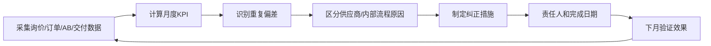

---

## 18. 结语

底盘采购并非单纯的下单活动，而是连接投标、工程、项目、生产计划、供应商、物流、质量和注册管理的全过程控制。采购人员必须坚持以最终有效技术文件为基准，以SAP订单为商业执行载体，以底盘总表为交期控制工具，以项目目录和SAP附件为审计依据，确保每一台底盘从询价到质量放行均可追溯、可验证、可交接。
