# 底盘采购全流程图解式标准作业程序（SOP）

> **版本**：V3.0（专业排版版）  
> **适用范围**：底盘询价、报价审核、中标后准备、SAP下单、订单审批、订单确认、交期管控、变更管理、到货入库、质量放行及资料归档  
> **阅读方式**：本文件以流程图为主。流程图统一采用纵向分层布局、大字号、加宽节点和增强间距，以便在 Markdown 预览、GitHub、VS Code 和 Typora 中阅读。每个节点均表示一个实际动作、检查点、判断条件或输出物。

---

## 流程图显示规范

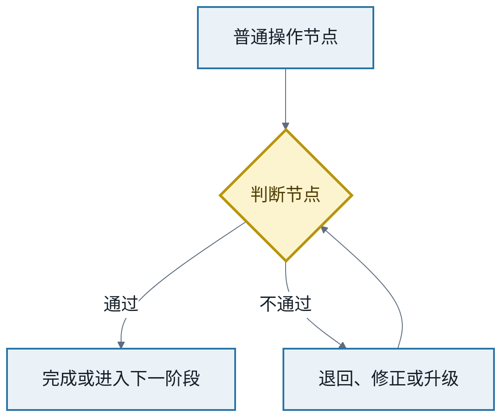

---

## 1. 全生命周期总流程

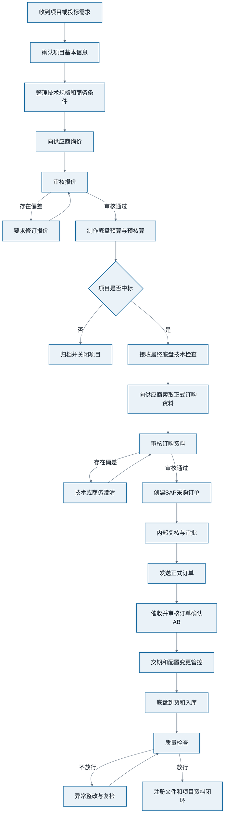

---

## 2. 采购角色协同流程

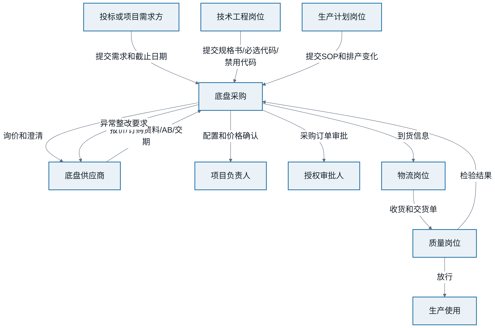

---

# 第一部分：询价与预算

## 3. 询价输入资料完整性检查

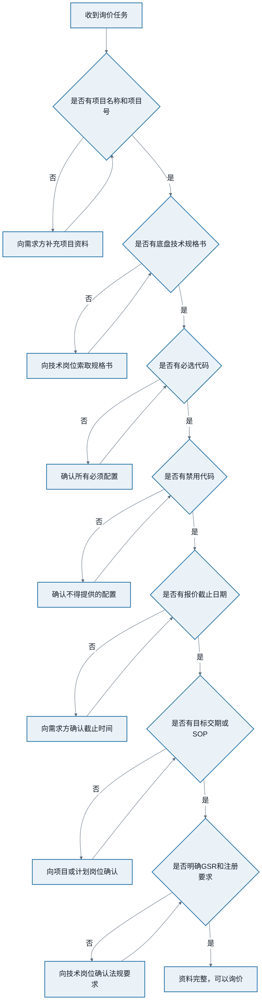

## 4. 询价文件夹建立与命名

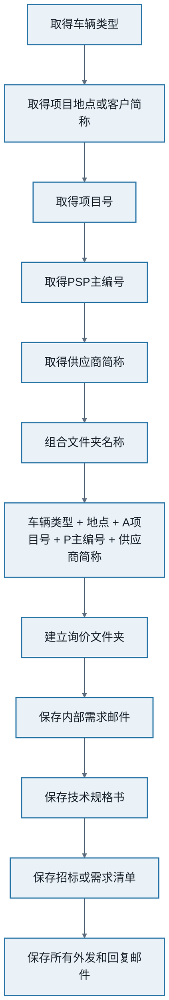

## 5. 供应商询价发送流程

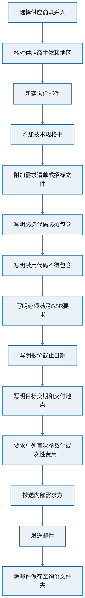

## 6. 报价催收流程

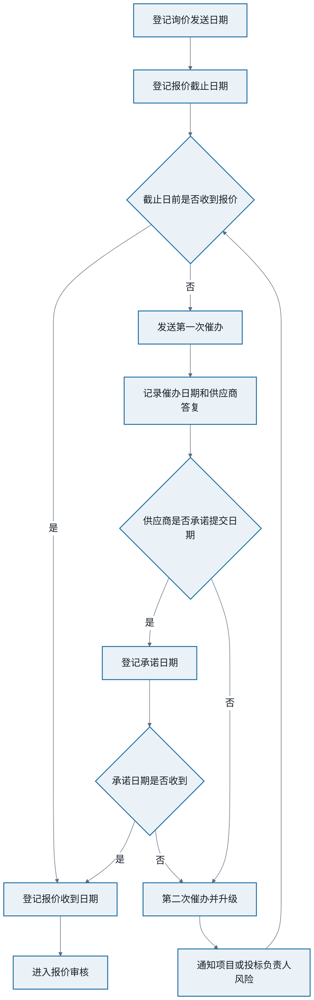

## 7. 报价技术审核流程

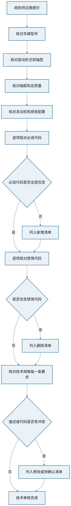

## 8. 报价商务审核流程

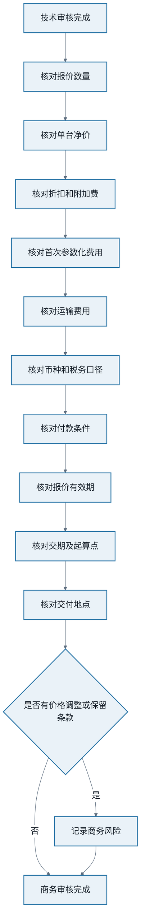

## 9. 报价偏差处理流程

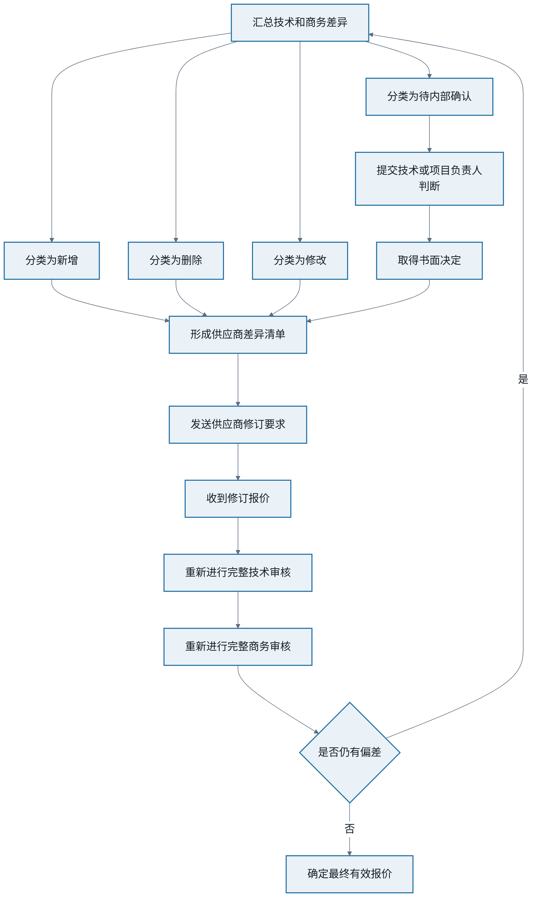

## 10. 预算与预核算流程

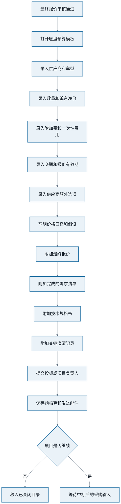

---

# 第二部分：中标后采购准备

## 11. 中标后项目文件夹结构

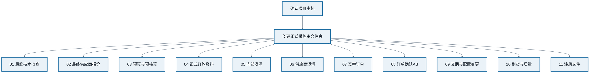

## 12. 最终底盘技术检查接收流程

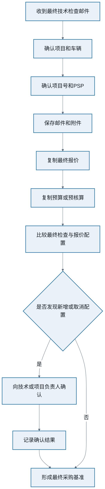

## 13. 向供应商索取正式订购资料

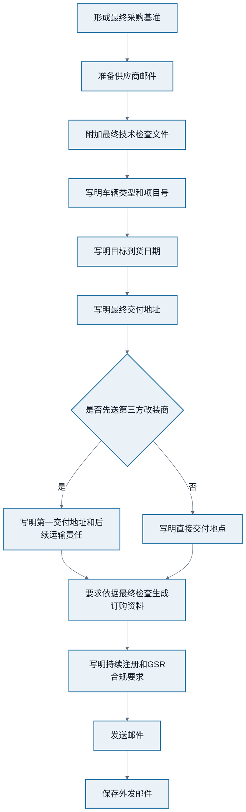

## 14. 正式订购资料审核流程

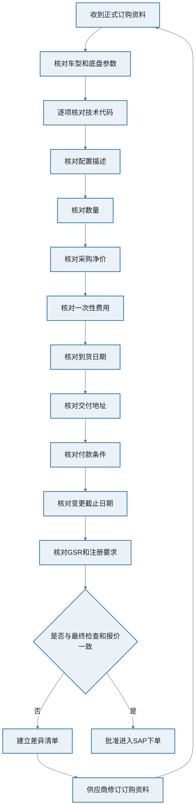

---

# 第三部分：SAP采购订单

## 15. SAP下单前数据准备流程

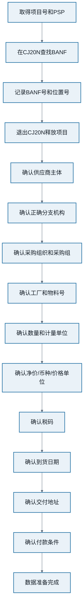

## 16. 供应商与分支机构选择流程

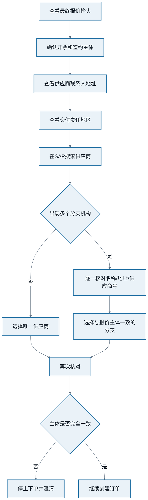

## 17. 到货日期确定流程

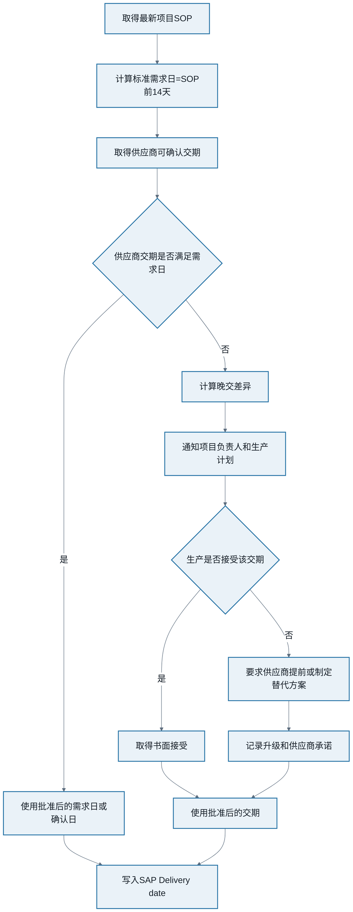

## 18. SAP订单创建主流程

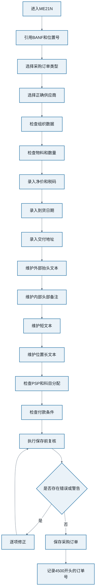

## 19. SAP订单文本维护流程

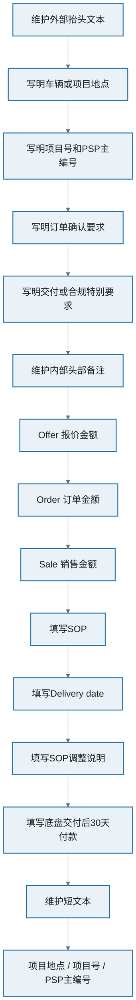

## 20. Offer、Order、Sale价格检查流程

```mermaid
%%{init: {'theme':'base','flowchart':{'curve':'basis','nodeSpacing':55,'rankSpacing':70,'padding':20,'htmlLabels':true,'useMaxWidth':false},'themeVariables':{'fontFamily':'Microsoft YaHei, Noto Sans SC, Arial, sans-serif','fontSize':'20px','primaryColor':'#EAF2F8','primaryTextColor':'#17202A','primaryBorderColor':'#2874A6','lineColor':'#5D6D7E','secondaryColor':'#FDF2E9','tertiaryColor':'#E8F8F5','clusterBkg':'#F8F9F9','clusterBorder':'#AAB7B8','edgeLabelBackground':'#FFFFFF'}}}%%
flowchart TB
    A[从最终报价取得Offer] --> B[从订购资料取得Order]
    B --> C[从客户订单取得Sale]
    C --> D[比较Offer与Order]
    D --> E{Offer与Order是否一致}
    E -->|否| F[查明配置变更/涨价/附加费]
    E -->|是| G[比较Order与Sale]
    F --> H[取得书面解释或批准]
    H --> G
    G --> I{Sale是否低于Order}
    I -->|是| J[暂停订单并通知项目负责人]
    J --> K[确认销售数据或批准亏损]
    K --> L[记录决定]
    I -->|否| M[价格检查通过]
    L --> M
    classDef default fill:#EAF2F8,stroke:#2874A6,stroke-width:2px,color:#17202A,font-size:20px;
    classDef decision fill:#FCF3CF,stroke:#B7950B,stroke-width:3px,color:#4D3B00,font-size:20px;
    classDef stop fill:#FDEDEC,stroke:#C0392B,stroke-width:3px,color:#641E16,font-size:20px;
    classDef success fill:#E8F8F5,stroke:#148F77,stroke-width:3px,color:#0B5345,font-size:20px;
```

## 21. SAP保存后复核与附件上传

```mermaid
%%{init: {'theme':'base','flowchart':{'curve':'basis','nodeSpacing':55,'rankSpacing':70,'padding':20,'htmlLabels':true,'useMaxWidth':false},'themeVariables':{'fontFamily':'Microsoft YaHei, Noto Sans SC, Arial, sans-serif','fontSize':'20px','primaryColor':'#EAF2F8','primaryTextColor':'#17202A','primaryBorderColor':'#2874A6','lineColor':'#5D6D7E','secondaryColor':'#FDF2E9','tertiaryColor':'#E8F8F5','clusterBkg':'#F8F9F9','clusterBorder':'#AAB7B8','edgeLabelBackground':'#FFFFFF'}}}%%
flowchart TB
    A[ME21N保存成功] --> B[自动系统邮件仅发内部邮箱]
    B --> C[退出ME21N]
    C --> D[进入ME23N]
    D --> E[核对供应商和订单号]
    E --> F[核对物料/数量/净价]
    F --> G[核对税码/交期/地址]
    G --> H[核对文本和PSP]
    H --> I{复核是否通过}
    I -->|否| J[修改订单并重新复核]
    J --> D
    I -->|是| K[上传最终报价]
    K --> L[上传正式订购资料]
    L --> M[上传最终技术检查]
    M --> N[上传关键澄清邮件]
    N --> O[更新底盘订单总表]
    classDef default fill:#EAF2F8,stroke:#2874A6,stroke-width:2px,color:#17202A,font-size:20px;
    classDef decision fill:#FCF3CF,stroke:#B7950B,stroke-width:3px,color:#4D3B00,font-size:20px;
    classDef stop fill:#FDEDEC,stroke:#C0392B,stroke-width:3px,color:#641E16,font-size:20px;
    classDef success fill:#E8F8F5,stroke:#148F77,stroke-width:3px,color:#0B5345,font-size:20px;
```

---

# 第四部分：审批与正式订单

## 22. 签字资料准备流程

```mermaid
%%{init: {'theme':'base','flowchart':{'curve':'basis','nodeSpacing':55,'rankSpacing':70,'padding':20,'htmlLabels':true,'useMaxWidth':false},'themeVariables':{'fontFamily':'Microsoft YaHei, Noto Sans SC, Arial, sans-serif','fontSize':'20px','primaryColor':'#EAF2F8','primaryTextColor':'#17202A','primaryBorderColor':'#2874A6','lineColor':'#5D6D7E','secondaryColor':'#FDF2E9','tertiaryColor':'#E8F8F5','clusterBkg':'#F8F9F9','clusterBorder':'#AAB7B8','edgeLabelBackground':'#FFFFFF'}}}%%
flowchart TB
    A[SAP订单复核通过] --> B[生成最终SAP订单文件]
    B --> C[打印或保存正式订购资料]
    C --> D[制作项目信息纸条]
    D --> E[填写项目/项目号/品牌或地点]
    E --> F[填写SAP订单号]
    F --> G[填写Offer/Order/Sale]
    G --> H[填写订单变更]
    H --> I[填写SOP和到货日期]
    I --> J[填写付款条件]
    J --> K[组合为完整签字包]
    classDef default fill:#EAF2F8,stroke:#2874A6,stroke-width:2px,color:#17202A,font-size:20px;
    classDef decision fill:#FCF3CF,stroke:#B7950B,stroke-width:3px,color:#4D3B00,font-size:20px;
    classDef stop fill:#FDEDEC,stroke:#C0392B,stroke-width:3px,color:#641E16,font-size:20px;
    classDef success fill:#E8F8F5,stroke:#148F77,stroke-width:3px,color:#0B5345,font-size:20px;
```

## 23. 审批流程

```mermaid
%%{init: {'theme':'base','flowchart':{'curve':'basis','nodeSpacing':55,'rankSpacing':70,'padding':20,'htmlLabels':true,'useMaxWidth':false},'themeVariables':{'fontFamily':'Microsoft YaHei, Noto Sans SC, Arial, sans-serif','fontSize':'20px','primaryColor':'#EAF2F8','primaryTextColor':'#17202A','primaryBorderColor':'#2874A6','lineColor':'#5D6D7E','secondaryColor':'#FDF2E9','tertiaryColor':'#E8F8F5','clusterBkg':'#F8F9F9','clusterBorder':'#AAB7B8','edgeLabelBackground':'#FFFFFF'}}}%%
flowchart TB
    A[提交签字包] --> B[授权审批人检查]
    B --> C{技术依据是否完整}
    C -->|否| D[退回补充技术文件]
    D --> A
    C -->|是| E{价格是否合理}
    E -->|否| F[退回解释价格差异]
    F --> A
    E -->|是| G{交期和付款条件是否可接受}
    G -->|否| H[退回重新协调]
    H --> A
    G -->|是| I[完成签字]
    I --> J[完成SAP审批]
    J --> K[扫描或保存签字版本]
    classDef default fill:#EAF2F8,stroke:#2874A6,stroke-width:2px,color:#17202A,font-size:20px;
    classDef decision fill:#FCF3CF,stroke:#B7950B,stroke-width:3px,color:#4D3B00,font-size:20px;
    classDef stop fill:#FDEDEC,stroke:#C0392B,stroke-width:3px,color:#641E16,font-size:20px;
    classDef success fill:#E8F8F5,stroke:#148F77,stroke-width:3px,color:#0B5345,font-size:20px;
```

## 24. 正式订单发送流程

```mermaid
%%{init: {'theme':'base','flowchart':{'curve':'basis','nodeSpacing':55,'rankSpacing':70,'padding':20,'htmlLabels':true,'useMaxWidth':false},'themeVariables':{'fontFamily':'Microsoft YaHei, Noto Sans SC, Arial, sans-serif','fontSize':'20px','primaryColor':'#EAF2F8','primaryTextColor':'#17202A','primaryBorderColor':'#2874A6','lineColor':'#5D6D7E','secondaryColor':'#FDF2E9','tertiaryColor':'#E8F8F5','clusterBkg':'#F8F9F9','clusterBorder':'#AAB7B8','edgeLabelBackground':'#FFFFFF'}}}%%
flowchart TB
    A[审批和签字完成] --> B[新建供应商订单邮件]
    B --> C[附加签字订购资料]
    C --> D[附加SAP采购订单]
    D --> E[写明车辆/项目/订单号]
    E --> F[写明到货日期和交付地点]
    F --> G[要求供应商安排生产]
    G --> H[要求发送订单确认AB]
    H --> I[指定订单确认公共邮箱]
    I --> J[写入持续注册和GSR合规要求]
    J --> K[核对附件和收件人]
    K --> L[发送正式订单]
    L --> M[保存外发邮件]
    M --> N[上传SAP并关联项目]
    classDef default fill:#EAF2F8,stroke:#2874A6,stroke-width:2px,color:#17202A,font-size:20px;
    classDef decision fill:#FCF3CF,stroke:#B7950B,stroke-width:3px,color:#4D3B00,font-size:20px;
    classDef stop fill:#FDEDEC,stroke:#C0392B,stroke-width:3px,color:#641E16,font-size:20px;
    classDef success fill:#E8F8F5,stroke:#148F77,stroke-width:3px,color:#0B5345,font-size:20px;
```

---

# 第五部分：订单确认AB

## 25. AB催收流程

```mermaid
%%{init: {'theme':'base','flowchart':{'curve':'basis','nodeSpacing':55,'rankSpacing':70,'padding':20,'htmlLabels':true,'useMaxWidth':false},'themeVariables':{'fontFamily':'Microsoft YaHei, Noto Sans SC, Arial, sans-serif','fontSize':'20px','primaryColor':'#EAF2F8','primaryTextColor':'#17202A','primaryBorderColor':'#2874A6','lineColor':'#5D6D7E','secondaryColor':'#FDF2E9','tertiaryColor':'#E8F8F5','clusterBkg':'#F8F9F9','clusterBorder':'#AAB7B8','edgeLabelBackground':'#FFFFFF'}}}%%
flowchart TB
    A[正式订单发送] --> B[登记发送日期]
    B --> C[设置AB要求回复日期]
    C --> D{回复日前是否收到AB}
    D -->|是| E[登记AB收到日期]
    E --> F[进入AB审核]
    D -->|否| G[发送第一次催收]
    G --> H[设置下一跟进日期]
    H --> I{是否收到明确回复}
    I -->|是| J[登记供应商承诺日期]
    J --> K{承诺日前是否收到}
    K -->|是| E
    K -->|否| L[第二次催收并升级]
    I -->|否| L
    L --> M[通知项目和采购管理]
    M --> D
    classDef default fill:#EAF2F8,stroke:#2874A6,stroke-width:2px,color:#17202A,font-size:20px;
    classDef decision fill:#FCF3CF,stroke:#B7950B,stroke-width:3px,color:#4D3B00,font-size:20px;
    classDef stop fill:#FDEDEC,stroke:#C0392B,stroke-width:3px,color:#641E16,font-size:20px;
    classDef success fill:#E8F8F5,stroke:#148F77,stroke-width:3px,color:#0B5345,font-size:20px;
```

## 26. AB完整审核流程

```mermaid
%%{init: {'theme':'base','flowchart':{'curve':'basis','nodeSpacing':55,'rankSpacing':70,'padding':20,'htmlLabels':true,'useMaxWidth':false},'themeVariables':{'fontFamily':'Microsoft YaHei, Noto Sans SC, Arial, sans-serif','fontSize':'20px','primaryColor':'#EAF2F8','primaryTextColor':'#17202A','primaryBorderColor':'#2874A6','lineColor':'#5D6D7E','secondaryColor':'#FDF2E9','tertiaryColor':'#E8F8F5','clusterBkg':'#F8F9F9','clusterBorder':'#AAB7B8','edgeLabelBackground':'#FFFFFF'}}}%%
flowchart TB
    A[打开AB] --> B[核对本方采购订单号]
    B --> C[登记供应商订单号]
    C --> D[登记短号/PIN/生产识别码]
    D --> E[核对车辆型号]
    E --> F[逐项核对技术代码]
    F --> G[核对数量]
    G --> H[核对净价和附加费]
    H --> I[核对币种和付款条件]
    I --> J[核对确认交期]
    J --> K[核对交付地址]
    K --> L[登记变更截止日期]
    L --> M[核对GSR和注册状态]
    M --> N{是否存在任何偏差}
    N -->|否| O[标记 已审核无偏差]
    O --> P[上传SAP并更新总表]
    N -->|是| Q[进入AB差异处理]
    classDef default fill:#EAF2F8,stroke:#2874A6,stroke-width:2px,color:#17202A,font-size:20px;
    classDef decision fill:#FCF3CF,stroke:#B7950B,stroke-width:3px,color:#4D3B00,font-size:20px;
    classDef stop fill:#FDEDEC,stroke:#C0392B,stroke-width:3px,color:#641E16,font-size:20px;
    classDef success fill:#E8F8F5,stroke:#148F77,stroke-width:3px,color:#0B5345,font-size:20px;
```

## 27. AB差异闭环流程

```mermaid
%%{init: {'theme':'base','flowchart':{'curve':'basis','nodeSpacing':55,'rankSpacing':70,'padding':20,'htmlLabels':true,'useMaxWidth':false},'themeVariables':{'fontFamily':'Microsoft YaHei, Noto Sans SC, Arial, sans-serif','fontSize':'20px','primaryColor':'#EAF2F8','primaryTextColor':'#17202A','primaryBorderColor':'#2874A6','lineColor':'#5D6D7E','secondaryColor':'#FDF2E9','tertiaryColor':'#E8F8F5','clusterBkg':'#F8F9F9','clusterBorder':'#AAB7B8','edgeLabelBackground':'#FFFFFF'}}}%%
flowchart TB
    A[发现AB差异] --> B{差异类型}
    B -->|技术配置| C[技术岗位评估]
    B -->|价格| D[核对涨价/附加费/折扣]
    B -->|交期| E[评估SOP和排产影响]
    B -->|地址或付款| F[采购核对合同条件]
    C --> G[形成处理决定]
    D --> G
    E --> G
    F --> G
    G --> H[向供应商发送差异清单]
    H --> I[要求修订AB或书面解释]
    I --> J[收到修订AB]
    J --> K[重新完整审核]
    K --> L{差异是否关闭}
    L -->|否| A
    L -->|是| M[上传最终AB和澄清记录]
    classDef default fill:#EAF2F8,stroke:#2874A6,stroke-width:2px,color:#17202A,font-size:20px;
    classDef decision fill:#FCF3CF,stroke:#B7950B,stroke-width:3px,color:#4D3B00,font-size:20px;
    classDef stop fill:#FDEDEC,stroke:#C0392B,stroke-width:3px,color:#641E16,font-size:20px;
    classDef success fill:#E8F8F5,stroke:#148F77,stroke-width:3px,color:#0B5345,font-size:20px;
```

---

# 第六部分：交期与变更管控

## 28. 每周交期管控数据更新

```mermaid
%%{init: {'theme':'base','flowchart':{'curve':'basis','nodeSpacing':55,'rankSpacing':70,'padding':20,'htmlLabels':true,'useMaxWidth':false},'themeVariables':{'fontFamily':'Microsoft YaHei, Noto Sans SC, Arial, sans-serif','fontSize':'20px','primaryColor':'#EAF2F8','primaryTextColor':'#17202A','primaryBorderColor':'#2874A6','lineColor':'#5D6D7E','secondaryColor':'#FDF2E9','tertiaryColor':'#E8F8F5','clusterBkg':'#F8F9F9','clusterBorder':'#AAB7B8','edgeLabelBackground':'#FFFFFF'}}}%%
flowchart TB
    A[每周五上午取得最新SOP] --> B[导入底盘总表]
    B --> C[匹配项目号和PSP]
    C --> D[更新每台底盘SOP]
    D --> E[导入供应商最新交期]
    E --> F[更新变更截止日期]
    F --> G[更新底盘当前状态]
    G --> H[更新责任人和下一跟进日]
    H --> I[保存更新版本]
    I --> J[保留上一版本用于追溯]
    classDef default fill:#EAF2F8,stroke:#2874A6,stroke-width:2px,color:#17202A,font-size:20px;
    classDef decision fill:#FCF3CF,stroke:#B7950B,stroke-width:3px,color:#4D3B00,font-size:20px;
    classDef stop fill:#FDEDEC,stroke:#C0392B,stroke-width:3px,color:#641E16,font-size:20px;
    classDef success fill:#E8F8F5,stroke:#148F77,stroke-width:3px,color:#0B5345,font-size:20px;
```

## 29. 管控对象筛选流程

```mermaid
%%{init: {'theme':'base','flowchart':{'curve':'basis','nodeSpacing':55,'rankSpacing':70,'padding':20,'htmlLabels':true,'useMaxWidth':false},'themeVariables':{'fontFamily':'Microsoft YaHei, Noto Sans SC, Arial, sans-serif','fontSize':'20px','primaryColor':'#EAF2F8','primaryTextColor':'#17202A','primaryBorderColor':'#2874A6','lineColor':'#5D6D7E','secondaryColor':'#FDF2E9','tertiaryColor':'#E8F8F5','clusterBkg':'#F8F9F9','clusterBorder':'#AAB7B8','edgeLabelBackground':'#FFFFFF'}}}%%
flowchart TB
    A[读取底盘总表] --> B[筛选已下单项目]
    B --> C[排除已取消订单]
    C --> D[排除已最终关闭项目]
    D --> E{状态是否已在本地仓库}
    E -->|是| F[移出交期催办清单]
    E -->|否| G{状态是否已在指定第三方仓库}
    G -->|是| F
    G -->|否| H[保留在管控清单]
    H --> I{SOP是否在未来一个季度}
    I -->|是| J[列为重点监管]
    I -->|否| K[列为常规监管]
    classDef default fill:#EAF2F8,stroke:#2874A6,stroke-width:2px,color:#17202A,font-size:20px;
    classDef decision fill:#FCF3CF,stroke:#B7950B,stroke-width:3px,color:#4D3B00,font-size:20px;
    classDef stop fill:#FDEDEC,stroke:#C0392B,stroke-width:3px,color:#641E16,font-size:20px;
    classDef success fill:#E8F8F5,stroke:#148F77,stroke-width:3px,color:#0B5345,font-size:20px;
```

## 30. 交期差异计算流程

```mermaid
%%{init: {'theme':'base','flowchart':{'curve':'basis','nodeSpacing':55,'rankSpacing':70,'padding':20,'htmlLabels':true,'useMaxWidth':false},'themeVariables':{'fontFamily':'Microsoft YaHei, Noto Sans SC, Arial, sans-serif','fontSize':'20px','primaryColor':'#EAF2F8','primaryTextColor':'#17202A','primaryBorderColor':'#2874A6','lineColor':'#5D6D7E','secondaryColor':'#FDF2E9','tertiaryColor':'#E8F8F5','clusterBkg':'#F8F9F9','clusterBorder':'#AAB7B8','edgeLabelBackground':'#FFFFFF'}}}%%
flowchart TB
    A[取得最新SOP日期] --> B[取得当前预计到货日期]
    B --> C[计算差异=SOP-预计到货]
    C --> D{差异结果}
    D -->|正数| E[底盘早于SOP到货]
    D -->|0| F[底盘在SOP当天到货]
    D -->|负数| G[底盘晚于SOP到货]
    E --> H{是否大于30天}
    H -->|否| I[通常可接受并继续观察]
    H -->|是| J[评估仓储和资金占用]
    G --> K{是否小于等于-14天}
    K -->|否| L[确认生产是否可吸收]
    K -->|是| M[严重晚交并升级处理]
    classDef default fill:#EAF2F8,stroke:#2874A6,stroke-width:2px,color:#17202A,font-size:20px;
    classDef decision fill:#FCF3CF,stroke:#B7950B,stroke-width:3px,color:#4D3B00,font-size:20px;
    classDef stop fill:#FDEDEC,stroke:#C0392B,stroke-width:3px,color:#641E16,font-size:20px;
    classDef success fill:#E8F8F5,stroke:#148F77,stroke-width:3px,color:#0B5345,font-size:20px;
```

## 31. 交期风险分级流程

```mermaid
%%{init: {'theme':'base','flowchart':{'curve':'basis','nodeSpacing':55,'rankSpacing':70,'padding':20,'htmlLabels':true,'useMaxWidth':false},'themeVariables':{'fontFamily':'Microsoft YaHei, Noto Sans SC, Arial, sans-serif','fontSize':'20px','primaryColor':'#EAF2F8','primaryTextColor':'#17202A','primaryBorderColor':'#2874A6','lineColor':'#5D6D7E','secondaryColor':'#FDF2E9','tertiaryColor':'#E8F8F5','clusterBkg':'#F8F9F9','clusterBorder':'#AAB7B8','edgeLabelBackground':'#FFFFFF'}}}%%
flowchart TB
    A[完成交期差异计算] --> B{供应商是否确认交期}
    B -->|否| C[红色风险]
    B -->|是| D{是否已影响SOP}
    D -->|是| C
    D -->|否| E{晚交是否超过14天}
    E -->|是| F[橙色风险]
    E -->|否| G{过早是否超过30天}
    G -->|是| F
    G -->|否| H{是否临近变更截止日期}
    H -->|是| I[黄色风险]
    H -->|否| J[绿色风险]
    C --> K[立即升级并制定替代方案]
    F --> L[书面纠正措施和高频跟进]
    I --> M[书面确认并设置下一跟进日]
    J --> N[保持周度监控]
    classDef default fill:#EAF2F8,stroke:#2874A6,stroke-width:2px,color:#17202A,font-size:20px;
    classDef decision fill:#FCF3CF,stroke:#B7950B,stroke-width:3px,color:#4D3B00,font-size:20px;
    classDef stop fill:#FDEDEC,stroke:#C0392B,stroke-width:3px,color:#641E16,font-size:20px;
    classDef success fill:#E8F8F5,stroke:#148F77,stroke-width:3px,color:#0B5345,font-size:20px;
```

## 32. 供应商交期催办与调整流程

```mermaid
%%{init: {'theme':'base','flowchart':{'curve':'basis','nodeSpacing':55,'rankSpacing':70,'padding':20,'htmlLabels':true,'useMaxWidth':false},'themeVariables':{'fontFamily':'Microsoft YaHei, Noto Sans SC, Arial, sans-serif','fontSize':'20px','primaryColor':'#EAF2F8','primaryTextColor':'#17202A','primaryBorderColor':'#2874A6','lineColor':'#5D6D7E','secondaryColor':'#FDF2E9','tertiaryColor':'#E8F8F5','clusterBkg':'#F8F9F9','clusterBorder':'#AAB7B8','edgeLabelBackground':'#FFFFFF'}}}%%
flowchart TB
    A[识别需提前或推迟的底盘] --> B[准备项目和订单信息]
    B --> C[说明当前SOP和现行交期]
    C --> D[说明要求的新交期]
    D --> E[向供应商发送书面请求]
    E --> F{供应商是否接受}
    F -->|是| G[取得书面确认]
    G --> H[更新总表和SAP必要字段]
    F -->|否| I[要求最早可行日期及原因]
    I --> J[评估生产影响]
    J --> K{项目是否接受}
    K -->|是| L[记录批准后的交期]
    K -->|否| M[升级管理并研究替代方案]
    L --> H
    M --> N[持续跟进直至关闭]
    classDef default fill:#EAF2F8,stroke:#2874A6,stroke-width:2px,color:#17202A,font-size:20px;
    classDef decision fill:#FCF3CF,stroke:#B7950B,stroke-width:3px,color:#4D3B00,font-size:20px;
    classDef stop fill:#FDEDEC,stroke:#C0392B,stroke-width:3px,color:#641E16,font-size:20px;
    classDef success fill:#E8F8F5,stroke:#148F77,stroke-width:3px,color:#0B5345,font-size:20px;
```

## 33. 变更截止日期管理流程

```mermaid
%%{init: {'theme':'base','flowchart':{'curve':'basis','nodeSpacing':55,'rankSpacing':70,'padding':20,'htmlLabels':true,'useMaxWidth':false},'themeVariables':{'fontFamily':'Microsoft YaHei, Noto Sans SC, Arial, sans-serif','fontSize':'20px','primaryColor':'#EAF2F8','primaryTextColor':'#17202A','primaryBorderColor':'#2874A6','lineColor':'#5D6D7E','secondaryColor':'#FDF2E9','tertiaryColor':'#E8F8F5','clusterBkg':'#F8F9F9','clusterBorder':'#AAB7B8','edgeLabelBackground':'#FFFFFF'}}}%%
flowchart TB
    A[读取供应商变更截止日期] --> B[计算距离截止日天数]
    B --> C{是否仍有未决技术问题}
    C -->|否| D[标记配置冻结]
    C -->|是| E{是否临近截止日}
    E -->|否| F[设置内部决定期限]
    F --> G[跟进项目和技术确认]
    E -->|是| H[立即发送升级通知]
    H --> I[召开快速决策或书面会签]
    I --> J{能否在截止日前决定}
    J -->|是| K[正式向供应商提交变更]
    J -->|否| L[评估错过截止日的费用和交期风险]
    K --> M[取得修订资料和确认]
    L --> N[管理层决定接受或取消变更]
    classDef default fill:#EAF2F8,stroke:#2874A6,stroke-width:2px,color:#17202A,font-size:20px;
    classDef decision fill:#FCF3CF,stroke:#B7950B,stroke-width:3px,color:#4D3B00,font-size:20px;
    classDef stop fill:#FDEDEC,stroke:#C0392B,stroke-width:3px,color:#641E16,font-size:20px;
    classDef success fill:#E8F8F5,stroke:#148F77,stroke-width:3px,color:#0B5345,font-size:20px;
```

## 34. 下单后配置变更流程

```mermaid
%%{init: {'theme':'base','flowchart':{'curve':'basis','nodeSpacing':55,'rankSpacing':70,'padding':20,'htmlLabels':true,'useMaxWidth':false},'themeVariables':{'fontFamily':'Microsoft YaHei, Noto Sans SC, Arial, sans-serif','fontSize':'20px','primaryColor':'#EAF2F8','primaryTextColor':'#17202A','primaryBorderColor':'#2874A6','lineColor':'#5D6D7E','secondaryColor':'#FDF2E9','tertiaryColor':'#E8F8F5','clusterBkg':'#F8F9F9','clusterBorder':'#AAB7B8','edgeLabelBackground':'#FFFFFF'}}}%%
flowchart TB
    A[收到配置变更请求] --> B[登记请求人/日期/原因]
    B --> C[记录当前配置与目标配置]
    C --> D[技术评估可行性]
    D --> E[供应商评估可实施性]
    E --> F[供应商报价变更费用]
    F --> G[供应商说明交期影响]
    G --> H[评估GSR和注册影响]
    H --> I{项目和技术是否批准}
    I -->|否| J[书面拒绝并关闭]
    I -->|是| K[取得修订订购资料]
    K --> L[修改SAP订单]
    L --> M[重新审批]
    M --> N[正式向供应商确认变更]
    N --> O[取得修订AB]
    O --> P[更新总表和项目档案]
    classDef default fill:#EAF2F8,stroke:#2874A6,stroke-width:2px,color:#17202A,font-size:20px;
    classDef decision fill:#FCF3CF,stroke:#B7950B,stroke-width:3px,color:#4D3B00,font-size:20px;
    classDef stop fill:#FDEDEC,stroke:#C0392B,stroke-width:3px,color:#641E16,font-size:20px;
    classDef success fill:#E8F8F5,stroke:#148F77,stroke-width:3px,color:#0B5345,font-size:20px;
```

---

# 第七部分：到货、入库与质量

## 35. 到货识别与总表更新流程

```mermaid
%%{init: {'theme':'base','flowchart':{'curve':'basis','nodeSpacing':55,'rankSpacing':70,'padding':20,'htmlLabels':true,'useMaxWidth':false},'themeVariables':{'fontFamily':'Microsoft YaHei, Noto Sans SC, Arial, sans-serif','fontSize':'20px','primaryColor':'#EAF2F8','primaryTextColor':'#17202A','primaryBorderColor':'#2874A6','lineColor':'#5D6D7E','secondaryColor':'#FDF2E9','tertiaryColor':'#E8F8F5','clusterBkg':'#F8F9F9','clusterBorder':'#AAB7B8','edgeLabelBackground':'#FFFFFF'}}}%%
flowchart TB
    A[收到物流到货通知] --> B[查看交货单和车辆信息]
    B --> C[根据供应商订单号匹配]
    C --> D[根据项目号或地点复核]
    D --> E[根据VIN最终确认]
    E --> F{是否唯一匹配}
    F -->|否| G[暂停入库并澄清身份]
    G --> C
    F -->|是| H[状态改为已到库]
    H --> I[录入实际到货日期]
    I --> J[录入VIN]
    J --> K[更新最后修改周次]
    K --> L[保存交货单PDF]
    classDef default fill:#EAF2F8,stroke:#2874A6,stroke-width:2px,color:#17202A,font-size:20px;
    classDef decision fill:#FCF3CF,stroke:#B7950B,stroke-width:3px,color:#4D3B00,font-size:20px;
    classDef stop fill:#FDEDEC,stroke:#C0392B,stroke-width:3px,color:#641E16,font-size:20px;
    classDef success fill:#E8F8F5,stroke:#148F77,stroke-width:3px,color:#0B5345,font-size:20px;
```

## 36. SAP到货主数据维护流程

```mermaid
%%{init: {'theme':'base','flowchart':{'curve':'basis','nodeSpacing':55,'rankSpacing':70,'padding':20,'htmlLabels':true,'useMaxWidth':false},'themeVariables':{'fontFamily':'Microsoft YaHei, Noto Sans SC, Arial, sans-serif','fontSize':'20px','primaryColor':'#EAF2F8','primaryTextColor':'#17202A','primaryBorderColor':'#2874A6','lineColor':'#5D6D7E','secondaryColor':'#FDF2E9','tertiaryColor':'#E8F8F5','clusterBkg':'#F8F9F9','clusterBorder':'#AAB7B8','edgeLabelBackground':'#FFFFFF'}}}%%
flowchart TB
    A[取得底盘物料号] --> B[使用MM03查询物料]
    B --> C[查看变更信息]
    C --> D{是否需要扩展分类视图}
    D -->|是| E[按授权使用MM01]
    D -->|否| F[进入现有分类信息]
    E --> F
    F --> G[维护VIN]
    G --> H[维护供应商订单号]
    H --> I[维护项目归属]
    I --> J[维护客户提供或自有属性]
    J --> K[从项目系统查询程序号]
    K --> L[录入程序号和地点信息]
    L --> M[交叉核对]
    M --> N[保存]
    classDef default fill:#EAF2F8,stroke:#2874A6,stroke-width:2px,color:#17202A,font-size:20px;
    classDef decision fill:#FCF3CF,stroke:#B7950B,stroke-width:3px,color:#4D3B00,font-size:20px;
    classDef stop fill:#FDEDEC,stroke:#C0392B,stroke-width:3px,color:#641E16,font-size:20px;
    classDef success fill:#E8F8F5,stroke:#148F77,stroke-width:3px,color:#0B5345,font-size:20px;
```

## 37. 到货质量检查流程

```mermaid
%%{init: {'theme':'base','flowchart':{'curve':'basis','nodeSpacing':55,'rankSpacing':70,'padding':20,'htmlLabels':true,'useMaxWidth':false},'themeVariables':{'fontFamily':'Microsoft YaHei, Noto Sans SC, Arial, sans-serif','fontSize':'20px','primaryColor':'#EAF2F8','primaryTextColor':'#17202A','primaryBorderColor':'#2874A6','lineColor':'#5D6D7E','secondaryColor':'#FDF2E9','tertiaryColor':'#E8F8F5','clusterBkg':'#F8F9F9','clusterBorder':'#AAB7B8','edgeLabelBackground':'#FFFFFF'}}}%%
flowchart TB
    A[底盘完成入库登记] --> B[向质量岗位发送检查通知]
    B --> C[附加交货单和订购基准]
    C --> D[核对VIN]
    D --> E[核对车型和技术配置]
    E --> F[核对AB确认配置]
    F --> G[检查外观和运输损伤]
    G --> H[检查随车文件]
    H --> I[检查法规和注册要求]
    I --> J{是否全部符合}
    J -->|是| K[质量放行]
    K --> L[更新总表和项目状态]
    J -->|否| M[创建不放行记录]
    classDef default fill:#EAF2F8,stroke:#2874A6,stroke-width:2px,color:#17202A,font-size:20px;
    classDef decision fill:#FCF3CF,stroke:#B7950B,stroke-width:3px,color:#4D3B00,font-size:20px;
    classDef stop fill:#FDEDEC,stroke:#C0392B,stroke-width:3px,color:#641E16,font-size:20px;
    classDef success fill:#E8F8F5,stroke:#148F77,stroke-width:3px,color:#0B5345,font-size:20px;
```

## 38. 质量不放行异常处理流程

```mermaid
%%{init: {'theme':'base','flowchart':{'curve':'basis','nodeSpacing':55,'rankSpacing':70,'padding':20,'htmlLabels':true,'useMaxWidth':false},'themeVariables':{'fontFamily':'Microsoft YaHei, Noto Sans SC, Arial, sans-serif','fontSize':'20px','primaryColor':'#EAF2F8','primaryTextColor':'#17202A','primaryBorderColor':'#2874A6','lineColor':'#5D6D7E','secondaryColor':'#FDF2E9','tertiaryColor':'#E8F8F5','clusterBkg':'#F8F9F9','clusterBorder':'#AAB7B8','edgeLabelBackground':'#FFFFFF'}}}%%
flowchart TB
    A[质量不放行] --> B[取得明确异常描述]
    B --> C{异常类别}
    C -->|配置缺失| D[核对订单和AB责任]
    C -->|错误配置| E[核对供应商生产偏差]
    C -->|运输损伤| F[核对物流责任和照片]
    C -->|文件缺失| G[要求补充文件]
    C -->|系统数据错误| H[内部修正主数据]
    D --> I[汇总证据]
    E --> I
    F --> I
    G --> I
    H --> I
    I --> J[向供应商发出书面异常通知]
    J --> K[明确整改措施/责任/期限/费用]
    K --> L[执行整改或补件]
    L --> M[质量复检]
    M --> N{是否通过}
    N -->|否| J
    N -->|是| O[正式放行并关闭异常]
    classDef default fill:#EAF2F8,stroke:#2874A6,stroke-width:2px,color:#17202A,font-size:20px;
    classDef decision fill:#FCF3CF,stroke:#B7950B,stroke-width:3px,color:#4D3B00,font-size:20px;
    classDef stop fill:#FDEDEC,stroke:#C0392B,stroke-width:3px,color:#641E16,font-size:20px;
    classDef success fill:#E8F8F5,stroke:#148F77,stroke-width:3px,color:#0B5345,font-size:20px;
```

---

# 第八部分：注册文件与归档

## 39. 注册文件处理流程

```mermaid
%%{init: {'theme':'base','flowchart':{'curve':'basis','nodeSpacing':55,'rankSpacing':70,'padding':20,'htmlLabels':true,'useMaxWidth':false},'themeVariables':{'fontFamily':'Microsoft YaHei, Noto Sans SC, Arial, sans-serif','fontSize':'20px','primaryColor':'#EAF2F8','primaryTextColor':'#17202A','primaryBorderColor':'#2874A6','lineColor':'#5D6D7E','secondaryColor':'#FDF2E9','tertiaryColor':'#E8F8F5','clusterBkg':'#F8F9F9','clusterBorder':'#AAB7B8','edgeLabelBackground':'#FFFFFF'}}}%%
flowchart TB
    A[收到车辆注册文件] --> B[登记收到日期]
    B --> C[核对VIN]
    C --> D[核对车型]
    D --> E[核对项目归属]
    E --> F{信息是否一致}
    F -->|否| G[冻结文件流转]
    G --> H[联系供应商修正]
    H --> C
    F -->|是| I[扫描并保存电子副本]
    I --> J[原件移交授权岗位]
    J --> K[邮件通知注册负责人]
    K --> L[上传SAP并更新总表]
    classDef default fill:#EAF2F8,stroke:#2874A6,stroke-width:2px,color:#17202A,font-size:20px;
    classDef decision fill:#FCF3CF,stroke:#B7950B,stroke-width:3px,color:#4D3B00,font-size:20px;
    classDef stop fill:#FDEDEC,stroke:#C0392B,stroke-width:3px,color:#641E16,font-size:20px;
    classDef success fill:#E8F8F5,stroke:#148F77,stroke-width:3px,color:#0B5345,font-size:20px;
```

## 40. 文件归档流程

```mermaid
%%{init: {'theme':'base','flowchart':{'curve':'basis','nodeSpacing':55,'rankSpacing':70,'padding':20,'htmlLabels':true,'useMaxWidth':false},'themeVariables':{'fontFamily':'Microsoft YaHei, Noto Sans SC, Arial, sans-serif','fontSize':'20px','primaryColor':'#EAF2F8','primaryTextColor':'#17202A','primaryBorderColor':'#2874A6','lineColor':'#5D6D7E','secondaryColor':'#FDF2E9','tertiaryColor':'#E8F8F5','clusterBkg':'#F8F9F9','clusterBorder':'#AAB7B8','edgeLabelBackground':'#FFFFFF'}}}%%
flowchart TB
    A[产生或收到新文件] --> B[添加日期和项目标识]
    B --> C[标注文件类型和版本]
    C --> D[保存至对应项目子文件夹]
    D --> E{是否为关键采购文件}
    E -->|是| F[上传SAP订单附件]
    E -->|否| G[保留在项目目录]
    F --> H{是否需要关联PSP}
    H -->|是| I[使用CV01N关联项目]
    H -->|否| J[检查附件可读性]
    I --> J
    G --> J
    J --> K[检查是否有旧版]
    K --> L[旧版标记版本或作废]
    L --> M[完成归档登记]
    classDef default fill:#EAF2F8,stroke:#2874A6,stroke-width:2px,color:#17202A,font-size:20px;
    classDef decision fill:#FCF3CF,stroke:#B7950B,stroke-width:3px,color:#4D3B00,font-size:20px;
    classDef stop fill:#FDEDEC,stroke:#C0392B,stroke-width:3px,color:#641E16,font-size:20px;
    classDef success fill:#E8F8F5,stroke:#148F77,stroke-width:3px,color:#0B5345,font-size:20px;
```

## 41. 项目结案完整性检查

```mermaid
%%{init: {'theme':'base','flowchart':{'curve':'basis','nodeSpacing':55,'rankSpacing':70,'padding':20,'htmlLabels':true,'useMaxWidth':false},'themeVariables':{'fontFamily':'Microsoft YaHei, Noto Sans SC, Arial, sans-serif','fontSize':'20px','primaryColor':'#EAF2F8','primaryTextColor':'#17202A','primaryBorderColor':'#2874A6','lineColor':'#5D6D7E','secondaryColor':'#FDF2E9','tertiaryColor':'#E8F8F5','clusterBkg':'#F8F9F9','clusterBorder':'#AAB7B8','edgeLabelBackground':'#FFFFFF'}}}%%
flowchart TB
    A[准备关闭底盘采购项目] --> B{最终报价是否归档}
    B -->|否| B1[补充最终报价]
    B1 --> B
    B -->|是| C{签字订单是否归档}
    C -->|否| C1[补充签字订单]
    C1 --> C
    C -->|是| D{最终AB是否归档}
    D -->|否| D1[补充最终AB]
    D1 --> D
    D -->|是| E{交期和变更记录是否完整}
    E -->|否| E1[补充历史记录]
    E1 --> E
    E -->|是| F{交货单和质量放行是否归档}
    F -->|否| F1[补充到货质量资料]
    F1 --> F
    F -->|是| G{注册文件状态是否明确}
    G -->|否| G1[追踪注册文件]
    G1 --> G
    G -->|是| H[项目资料闭环]
    classDef default fill:#EAF2F8,stroke:#2874A6,stroke-width:2px,color:#17202A,font-size:20px;
    classDef decision fill:#FCF3CF,stroke:#B7950B,stroke-width:3px,color:#4D3B00,font-size:20px;
    classDef stop fill:#FDEDEC,stroke:#C0392B,stroke-width:3px,color:#641E16,font-size:20px;
    classDef success fill:#E8F8F5,stroke:#148F77,stroke-width:3px,color:#0B5345,font-size:20px;
```

---

# 第九部分：周期性工作与管理

## 42. 每日工作流程

```mermaid
%%{init: {'theme':'base','flowchart':{'curve':'basis','nodeSpacing':55,'rankSpacing':70,'padding':20,'htmlLabels':true,'useMaxWidth':false},'themeVariables':{'fontFamily':'Microsoft YaHei, Noto Sans SC, Arial, sans-serif','fontSize':'20px','primaryColor':'#EAF2F8','primaryTextColor':'#17202A','primaryBorderColor':'#2874A6','lineColor':'#5D6D7E','secondaryColor':'#FDF2E9','tertiaryColor':'#E8F8F5','clusterBkg':'#F8F9F9','clusterBorder':'#AAB7B8','edgeLabelBackground':'#FFFFFF'}}}%%
flowchart TB
    A[检查供应商和内部邮件] --> B[处理紧急交期和质量异常]
    B --> C[更新底盘总表]
    C --> D[检查待下单项目]
    D --> E[使用ME57检查BANF]
    E --> F[跟进未收报价]
    F --> G[跟进未收订购资料]
    G --> H[跟进未收AB]
    H --> I[处理发票或价格问题]
    I --> J[更新责任人和下一跟进日]
    J --> K[保存每日备份]
    classDef default fill:#EAF2F8,stroke:#2874A6,stroke-width:2px,color:#17202A,font-size:20px;
    classDef decision fill:#FCF3CF,stroke:#B7950B,stroke-width:3px,color:#4D3B00,font-size:20px;
    classDef stop fill:#FDEDEC,stroke:#C0392B,stroke-width:3px,color:#641E16,font-size:20px;
    classDef success fill:#E8F8F5,stroke:#148F77,stroke-width:3px,color:#0B5345,font-size:20px;
```

## 43. 每周工作流程

```mermaid
%%{init: {'theme':'base','flowchart':{'curve':'basis','nodeSpacing':55,'rankSpacing':70,'padding':20,'htmlLabels':true,'useMaxWidth':false},'themeVariables':{'fontFamily':'Microsoft YaHei, Noto Sans SC, Arial, sans-serif','fontSize':'20px','primaryColor':'#EAF2F8','primaryTextColor':'#17202A','primaryBorderColor':'#2874A6','lineColor':'#5D6D7E','secondaryColor':'#FDF2E9','tertiaryColor':'#E8F8F5','clusterBkg':'#F8F9F9','clusterBorder':'#AAB7B8','edgeLabelBackground':'#FFFFFF'}}}%%
flowchart TB
    A[导入新增待下单项目] --> B[核对项目是否可下单]
    B --> C[周五更新最新SOP]
    C --> D[重新计算交期差异]
    D --> E[筛选未来一个季度底盘]
    E --> F[检查变更截止日期]
    F --> G[更新绿黄橙红风险]
    G --> H[跟进橙色和红色项目]
    H --> I[通知项目和计划岗位]
    I --> J[记录措施和下一跟进日]
    classDef default fill:#EAF2F8,stroke:#2874A6,stroke-width:2px,color:#17202A,font-size:20px;
    classDef decision fill:#FCF3CF,stroke:#B7950B,stroke-width:3px,color:#4D3B00,font-size:20px;
    classDef stop fill:#FDEDEC,stroke:#C0392B,stroke-width:3px,color:#641E16,font-size:20px;
    classDef success fill:#E8F8F5,stroke:#148F77,stroke-width:3px,color:#0B5345,font-size:20px;
```

## 44. 每月管理复盘流程

```mermaid
%%{init: {'theme':'base','flowchart':{'curve':'basis','nodeSpacing':55,'rankSpacing':70,'padding':20,'htmlLabels':true,'useMaxWidth':false},'themeVariables':{'fontFamily':'Microsoft YaHei, Noto Sans SC, Arial, sans-serif','fontSize':'20px','primaryColor':'#EAF2F8','primaryTextColor':'#17202A','primaryBorderColor':'#2874A6','lineColor':'#5D6D7E','secondaryColor':'#FDF2E9','tertiaryColor':'#E8F8F5','clusterBkg':'#F8F9F9','clusterBorder':'#AAB7B8','edgeLabelBackground':'#FFFFFF'}}}%%
flowchart TB
    A[统计新下单数量] --> B[统计未回AB数量]
    B --> C[统计延期和提前到货]
    C --> D[统计质量不放行]
    D --> E[统计配置和价格偏差]
    E --> F[计算供应商准时交付率]
    F --> G[计算一次质量放行率]
    G --> H[识别重复异常]
    H --> I{原因来自供应商还是内部}
    I -->|供应商| J[制定供应商改进措施]
    I -->|内部| K[修订流程和检查清单]
    J --> L[指定责任人和期限]
    K --> L
    L --> M[下月验证改善效果]
    classDef default fill:#EAF2F8,stroke:#2874A6,stroke-width:2px,color:#17202A,font-size:20px;
    classDef decision fill:#FCF3CF,stroke:#B7950B,stroke-width:3px,color:#4D3B00,font-size:20px;
    classDef stop fill:#FDEDEC,stroke:#C0392B,stroke-width:3px,color:#641E16,font-size:20px;
    classDef success fill:#E8F8F5,stroke:#148F77,stroke-width:3px,color:#0B5345,font-size:20px;
```

---

# 第十部分：质量门与快速检查

## 45. 七个质量门总流程

```mermaid
%%{init: {'theme':'base','flowchart':{'curve':'basis','nodeSpacing':55,'rankSpacing':70,'padding':20,'htmlLabels':true,'useMaxWidth':false},'themeVariables':{'fontFamily':'Microsoft YaHei, Noto Sans SC, Arial, sans-serif','fontSize':'20px','primaryColor':'#EAF2F8','primaryTextColor':'#17202A','primaryBorderColor':'#2874A6','lineColor':'#5D6D7E','secondaryColor':'#FDF2E9','tertiaryColor':'#E8F8F5','clusterBkg':'#F8F9F9','clusterBorder':'#AAB7B8','edgeLabelBackground':'#FFFFFF'}}}%%
flowchart TB
    A[QG1 询价资料完整] --> B[QG2 报价技术商务一致]
    B --> C[QG3 订购资料审核通过]
    C --> D[QG4 SAP订单和审批完成]
    D --> E[QG5 AB审核无未关闭偏差]
    E --> F[QG6 到货质量正式放行]
    F --> G[QG7 资料归档和风险关闭]
    A -->|不通过| A1[补齐资料后重新检查]
    B -->|不通过| B1[供应商修订报价]
    C -->|不通过| C1[供应商修订订购资料]
    D -->|不通过| D1[禁止发送正式订单]
    E -->|不通过| E1[修订AB或批准偏差]
    F -->|不通过| F1[整改和复检]
    G -->|不通过| G1[项目保持待办状态]
    classDef default fill:#EAF2F8,stroke:#2874A6,stroke-width:2px,color:#17202A,font-size:20px;
    classDef decision fill:#FCF3CF,stroke:#B7950B,stroke-width:3px,color:#4D3B00,font-size:20px;
    classDef stop fill:#FDEDEC,stroke:#C0392B,stroke-width:3px,color:#641E16,font-size:20px;
    classDef success fill:#E8F8F5,stroke:#148F77,stroke-width:3px,color:#0B5345,font-size:20px;
```

## 46. 下单前快速判断流程

```mermaid
%%{init: {'theme':'base','flowchart':{'curve':'basis','nodeSpacing':55,'rankSpacing':70,'padding':20,'htmlLabels':true,'useMaxWidth':false},'themeVariables':{'fontFamily':'Microsoft YaHei, Noto Sans SC, Arial, sans-serif','fontSize':'20px','primaryColor':'#EAF2F8','primaryTextColor':'#17202A','primaryBorderColor':'#2874A6','lineColor':'#5D6D7E','secondaryColor':'#FDF2E9','tertiaryColor':'#E8F8F5','clusterBkg':'#F8F9F9','clusterBorder':'#AAB7B8','edgeLabelBackground':'#FFFFFF'}}}%%
flowchart TB
    A[准备创建采购订单] --> B{最终技术检查是否有效}
    B -->|否| X[停止下单]
    B -->|是| C{最终报价是否有效}
    C -->|否| X
    C -->|是| D{订购资料是否无偏差}
    D -->|否| X
    D -->|是| E{供应商主体是否正确}
    E -->|否| X
    E -->|是| F{BANF和PSP是否正确}
    F -->|否| X
    F -->|是| G{价格和税码是否正确}
    G -->|否| X
    G -->|是| H{到货日期和地址是否批准}
    H -->|否| X
    H -->|是| I[允许进入ME21N下单]
    classDef default fill:#EAF2F8,stroke:#2874A6,stroke-width:2px,color:#17202A,font-size:20px;
    classDef decision fill:#FCF3CF,stroke:#B7950B,stroke-width:3px,color:#4D3B00,font-size:20px;
    classDef stop fill:#FDEDEC,stroke:#C0392B,stroke-width:3px,color:#641E16,font-size:20px;
    classDef success fill:#E8F8F5,stroke:#148F77,stroke-width:3px,color:#0B5345,font-size:20px;
```

## 47. 订单发送前快速判断流程

```mermaid
%%{init: {'theme':'base','flowchart':{'curve':'basis','nodeSpacing':55,'rankSpacing':70,'padding':20,'htmlLabels':true,'useMaxWidth':false},'themeVariables':{'fontFamily':'Microsoft YaHei, Noto Sans SC, Arial, sans-serif','fontSize':'20px','primaryColor':'#EAF2F8','primaryTextColor':'#17202A','primaryBorderColor':'#2874A6','lineColor':'#5D6D7E','secondaryColor':'#FDF2E9','tertiaryColor':'#E8F8F5','clusterBkg':'#F8F9F9','clusterBorder':'#AAB7B8','edgeLabelBackground':'#FFFFFF'}}}%%
flowchart TB
    A[准备向供应商发送订单] --> B{ME23N复核是否通过}
    B -->|否| X[禁止发送]
    B -->|是| C{SAP审批是否完成}
    C -->|否| X
    C -->|是| D{签字文件是否完整}
    D -->|否| X
    D -->|是| E{订单号和项目是否正确}
    E -->|否| X
    E -->|是| F{到货日期和交付地址是否正确}
    F -->|否| X
    F -->|是| G{是否要求AB和生产排期}
    G -->|否| X
    G -->|是| H{是否包含持续GSR合规要求}
    H -->|否| X
    H -->|是| I[允许发送正式订单]
    classDef default fill:#EAF2F8,stroke:#2874A6,stroke-width:2px,color:#17202A,font-size:20px;
    classDef decision fill:#FCF3CF,stroke:#B7950B,stroke-width:3px,color:#4D3B00,font-size:20px;
    classDef stop fill:#FDEDEC,stroke:#C0392B,stroke-width:3px,color:#641E16,font-size:20px;
    classDef success fill:#E8F8F5,stroke:#148F77,stroke-width:3px,color:#0B5345,font-size:20px;
```

## 48. 到货放行前快速判断流程

```mermaid
%%{init: {'theme':'base','flowchart':{'curve':'basis','nodeSpacing':55,'rankSpacing':70,'padding':20,'htmlLabels':true,'useMaxWidth':false},'themeVariables':{'fontFamily':'Microsoft YaHei, Noto Sans SC, Arial, sans-serif','fontSize':'20px','primaryColor':'#EAF2F8','primaryTextColor':'#17202A','primaryBorderColor':'#2874A6','lineColor':'#5D6D7E','secondaryColor':'#FDF2E9','tertiaryColor':'#E8F8F5','clusterBkg':'#F8F9F9','clusterBorder':'#AAB7B8','edgeLabelBackground':'#FFFFFF'}}}%%
flowchart TB
    A[底盘已到货] --> B{项目和订单是否匹配}
    B -->|否| X[暂停入库]
    B -->|是| C{VIN是否一致}
    C -->|否| X
    C -->|是| D{配置是否符合订单和AB}
    D -->|否| Y[质量不放行]
    D -->|是| E{外观是否无运输损伤}
    E -->|否| Y
    E -->|是| F{随车和注册文件是否完整}
    F -->|否| Y
    F -->|是| G{SAP和总表是否更新}
    G -->|否| H[补充系统数据]
    H --> G
    G -->|是| I[质量放行并转生产]
    classDef default fill:#EAF2F8,stroke:#2874A6,stroke-width:2px,color:#17202A,font-size:20px;
    classDef decision fill:#FCF3CF,stroke:#B7950B,stroke-width:3px,color:#4D3B00,font-size:20px;
    classDef stop fill:#FDEDEC,stroke:#C0392B,stroke-width:3px,color:#641E16,font-size:20px;
    classDef success fill:#E8F8F5,stroke:#148F77,stroke-width:3px,color:#0B5345,font-size:20px;
```

---

## 49. 关键规则速查

```mermaid
%%{init: {'theme':'base','flowchart':{'curve':'basis','nodeSpacing':55,'rankSpacing':70,'padding':20,'htmlLabels':true,'useMaxWidth':false},'themeVariables':{'fontFamily':'Microsoft YaHei, Noto Sans SC, Arial, sans-serif','fontSize':'20px','primaryColor':'#EAF2F8','primaryTextColor':'#17202A','primaryBorderColor':'#2874A6','lineColor':'#5D6D7E','secondaryColor':'#FDF2E9','tertiaryColor':'#E8F8F5','clusterBkg':'#F8F9F9','clusterBorder':'#AAB7B8','edgeLabelBackground':'#FFFFFF'}}}%%
flowchart TB
    A[交期差异=SOP-到货日期] --> B[正数=早到]
    A --> C[负数=晚到]
    B --> D[超过+30天 评估推迟]
    C --> E[低于或等于-14天 升级晚交风险]
    classDef default fill:#EAF2F8,stroke:#2874A6,stroke-width:2px,color:#17202A,font-size:20px;
    classDef decision fill:#FCF3CF,stroke:#B7950B,stroke-width:3px,color:#4D3B00,font-size:20px;
    classDef stop fill:#FDEDEC,stroke:#C0392B,stroke-width:3px,color:#641E16,font-size:20px;
    classDef success fill:#E8F8F5,stroke:#148F77,stroke-width:3px,color:#0B5345,font-size:20px;
```

```mermaid
%%{init: {'theme':'base','flowchart':{'curve':'basis','nodeSpacing':55,'rankSpacing':70,'padding':20,'htmlLabels':true,'useMaxWidth':false},'themeVariables':{'fontFamily':'Microsoft YaHei, Noto Sans SC, Arial, sans-serif','fontSize':'20px','primaryColor':'#EAF2F8','primaryTextColor':'#17202A','primaryBorderColor':'#2874A6','lineColor':'#5D6D7E','secondaryColor':'#FDF2E9','tertiaryColor':'#E8F8F5','clusterBkg':'#F8F9F9','clusterBorder':'#AAB7B8','edgeLabelBackground':'#FFFFFF'}}}%%
flowchart TB
    A[订单金额检查] --> B[Offer=最终报价]
    A --> C[Order=正式订购资料和SAP订单]
    A --> D[Sale=客户订单中的底盘销售价]
    B --> E[比较Offer与Order]
    C --> E
    E --> F[比较Order与Sale]
    D --> F
    F --> G{Sale低于Order}
    G -->|是| H[暂停并书面确认]
    G -->|否| I[价格检查通过]
    classDef default fill:#EAF2F8,stroke:#2874A6,stroke-width:2px,color:#17202A,font-size:20px;
    classDef decision fill:#FCF3CF,stroke:#B7950B,stroke-width:3px,color:#4D3B00,font-size:20px;
    classDef stop fill:#FDEDEC,stroke:#C0392B,stroke-width:3px,color:#641E16,font-size:20px;
    classDef success fill:#E8F8F5,stroke:#148F77,stroke-width:3px,color:#0B5345,font-size:20px;
```

```mermaid
%%{init: {'theme':'base','flowchart':{'curve':'basis','nodeSpacing':55,'rankSpacing':70,'padding':20,'htmlLabels':true,'useMaxWidth':false},'themeVariables':{'fontFamily':'Microsoft YaHei, Noto Sans SC, Arial, sans-serif','fontSize':'20px','primaryColor':'#EAF2F8','primaryTextColor':'#17202A','primaryBorderColor':'#2874A6','lineColor':'#5D6D7E','secondaryColor':'#FDF2E9','tertiaryColor':'#E8F8F5','clusterBkg':'#F8F9F9','clusterBorder':'#AAB7B8','edgeLabelBackground':'#FFFFFF'}}}%%
flowchart TB
    A[底盘合规控制] --> B[询价阶段写明GSR要求]
    B --> C[订购资料阶段再次确认]
    C --> D[正式订单写明持续可注册]
    D --> E[AB审核确认状态]
    E --> F[到货质量检查法规和文件]
    F --> G[整车制造期间保持合规]
    classDef default fill:#EAF2F8,stroke:#2874A6,stroke-width:2px,color:#17202A,font-size:20px;
    classDef decision fill:#FCF3CF,stroke:#B7950B,stroke-width:3px,color:#4D3B00,font-size:20px;
    classDef stop fill:#FDEDEC,stroke:#C0392B,stroke-width:3px,color:#641E16,font-size:20px;
    classDef success fill:#E8F8F5,stroke:#148F77,stroke-width:3px,color:#0B5345,font-size:20px;
```

---

## 50. 结案状态

```mermaid
%%{init: {'theme':'base','flowchart':{'curve':'basis','nodeSpacing':55,'rankSpacing':70,'padding':20,'htmlLabels':true,'useMaxWidth':false},'themeVariables':{'fontFamily':'Microsoft YaHei, Noto Sans SC, Arial, sans-serif','fontSize':'20px','primaryColor':'#EAF2F8','primaryTextColor':'#17202A','primaryBorderColor':'#2874A6','lineColor':'#5D6D7E','secondaryColor':'#FDF2E9','tertiaryColor':'#E8F8F5','clusterBkg':'#F8F9F9','clusterBorder':'#AAB7B8','edgeLabelBackground':'#FFFFFF'}}}%%
flowchart TB
    A[底盘质量放行] --> B[交货单已归档]
    B --> C[最终AB已归档]
    C --> D[所有变更已关闭]
    D --> E[注册文件状态明确]
    E --> F[SAP附件完整]
    F --> G[项目目录版本完整]
    G --> H[底盘采购流程正式结案]
    classDef default fill:#EAF2F8,stroke:#2874A6,stroke-width:2px,color:#17202A,font-size:20px;
    classDef decision fill:#FCF3CF,stroke:#B7950B,stroke-width:3px,color:#4D3B00,font-size:20px;
    classDef stop fill:#FDEDEC,stroke:#C0392B,stroke-width:3px,color:#641E16,font-size:20px;
    classDef success fill:#E8F8F5,stroke:#148F77,stroke-width:3px,color:#0B5345,font-size:20px;
```
