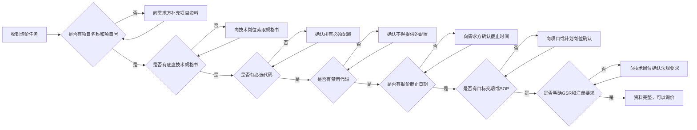
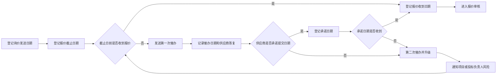
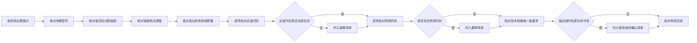
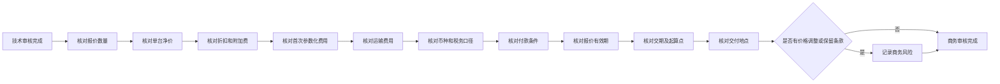
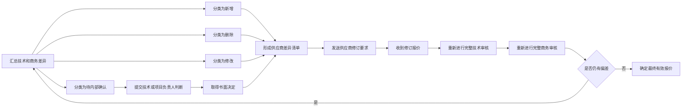
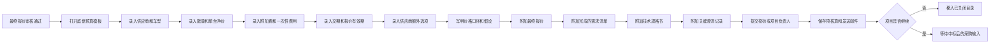

# 第一部分：询价与预算

> **流程目标**：形成技术完整、商务可比且可追溯的采购基准。  
> **主要责任角色**：底盘采购；协同角色：项目、技术、投标。  
> **关键控制**：资料完整性、配置一致性、报价有效期与风险假设。

## 3. 询价输入资料完整性检查

## 4. 询价文件夹建立与命名

## 5. 供应商询价发送流程

## 6. 报价催收流程

## 7. 报价技术审核流程

## 8. 报价商务审核流程

## 9. 报价偏差处理流程

## 10. 预算与预核算流程

---

[← 返回总目录](../README.md)
