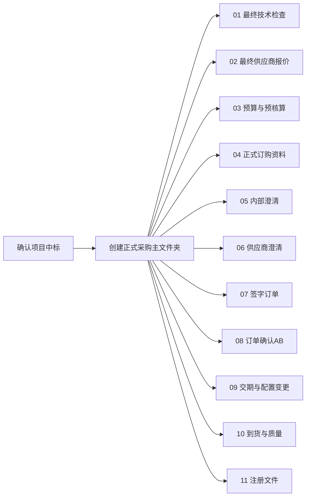
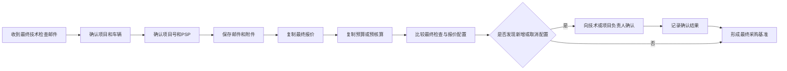
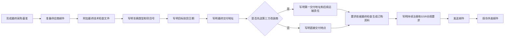
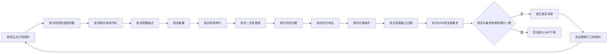

# 第二部分：中标后采购准备

> **流程目标**：将中标方案转换为可执行、无歧义的正式订购基准。  
> **主要责任角色**：底盘采购；协同角色：项目、技术、供应商。  
> **关键控制**：最终技术检查、最终报价和订购资料三方一致。

## 11. 中标后项目文件夹结构

## 12. 最终底盘技术检查接收流程

## 13. 向供应商索取正式订购资料

## 14. 正式订购资料审核流程

---

[← 返回总目录](../README.md)
