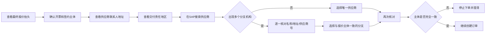
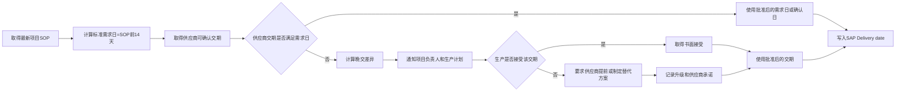
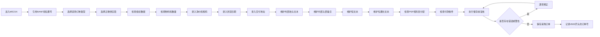
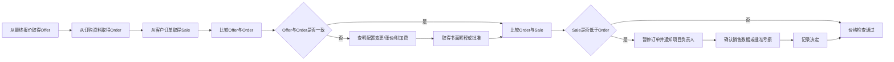
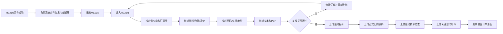

# 第三部分：SAP采购订单

> **流程目标**：在SAP中建立准确、获批且可审计的采购承诺。  
> **主要责任角色**：底盘采购；审批角色：授权审批人。  
> **关键控制**：供应商主体、BANF/PSP、价格、税码、交期、地址及文本。

## 15. SAP下单前数据准备流程

## 16. 供应商与分支机构选择流程

## 17. 到货日期确定流程

## 18. SAP订单创建主流程

## 19. SAP订单文本维护流程

```mermaid
graph LR
    A["维护外部抬头文本"] --> B["写明车辆或项目地点"]
    B --> C["写明项目号和PSP主编号"]
    C --> D["写明订单确认要求"]
    D --> E["写明交付或合规特别要求"]
    E --> F["维护内部头部备注"]
    F --> G["Offer 报价金额"]
    G --> H["Order 订单金额"]
    H --> I["Sale 销售金额"]
    I --> J["填写SOP"]
    J --> K["填写Delivery date"]
    K --> L["填写SOP调整说明"]
    L --> M["填写底盘交付后30天付款"]
    M --> N["维护短文本"]
    N --> O["项目地点 / 项目号 / PSP主编号"]
```

## 20. Offer、Order、Sale价格检查流程

## 21. SAP保存后复核与附件上传

---

[← 返回总目录](../README.md)
