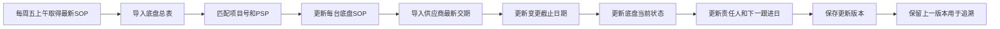
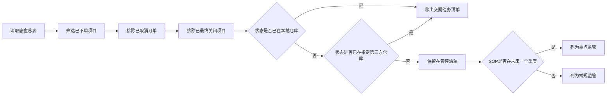
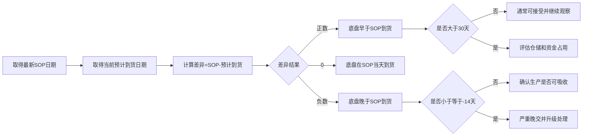
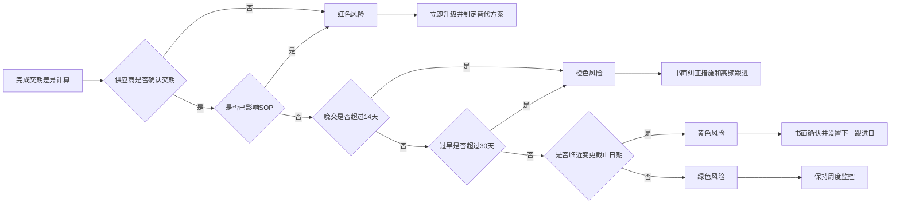
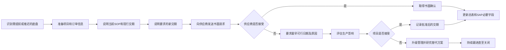
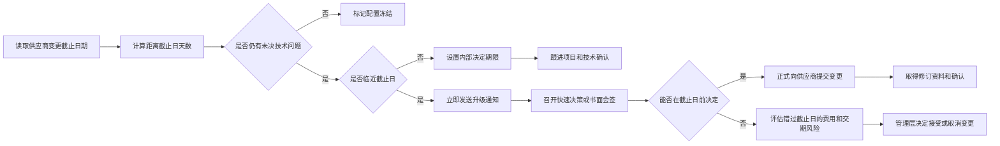
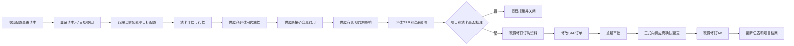

# 第六部分：交期与变更管控

> **流程目标**：使供应商交付计划与项目SOP、配置冻结和生产需求持续一致。  
> **主要责任角色**：底盘采购；协同角色：项目、计划、技术、供应商。  
> **关键控制**：周度更新、风险分级、书面变更、升级与闭环。

## 28. 每周交期管控数据更新

## 29. 管控对象筛选流程

## 30. 交期差异计算流程

## 31. 交期风险分级流程

## 32. 供应商交期催办与调整流程

## 33. 变更截止日期管理流程

## 34. 下单后配置变更流程

---

[← 返回总目录](../README.md)
