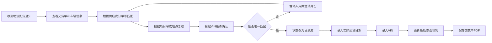
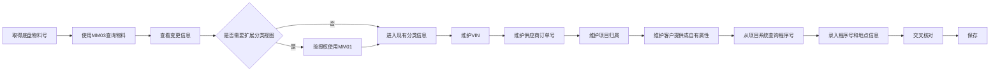
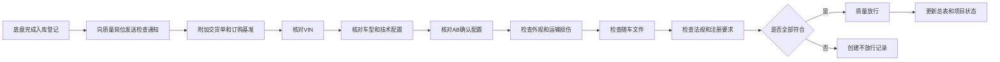
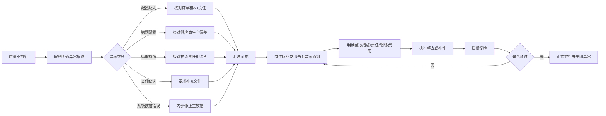

# 第七部分：到货、入库与质量

> **流程目标**：确保实际到货底盘身份、配置、状态和文件符合订购要求。  
> **主要责任角色**：物流与质量；采购负责供应商异常闭环。  
> **关键控制**：VIN匹配、系统数据、质量放行和不合格整改。

## 35. 到货识别与总表更新流程

## 36. SAP到货主数据维护流程

## 37. 到货质量检查流程

## 38. 质量不放行异常处理流程

---

[← 返回总目录](../README.md)
