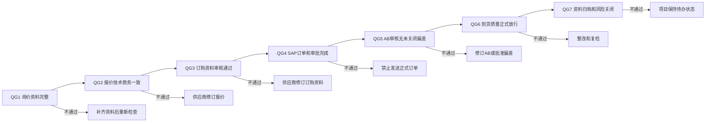
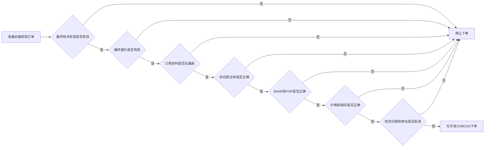
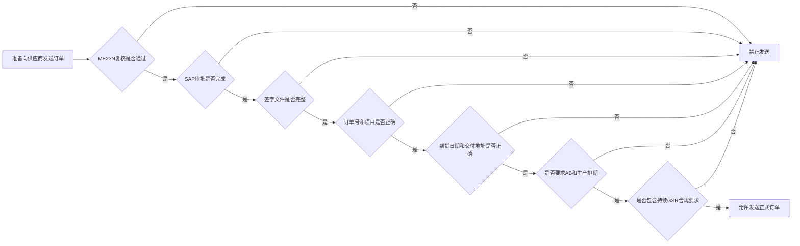
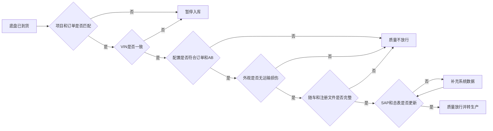
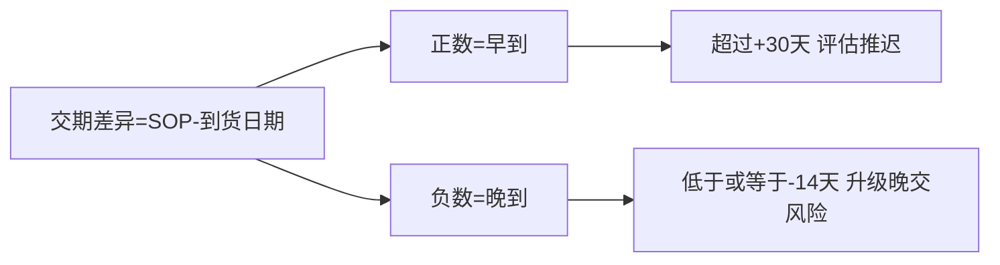
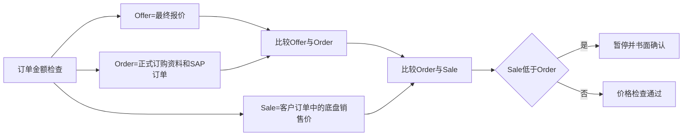
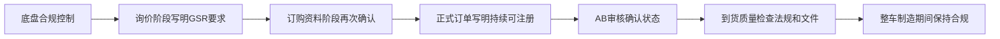
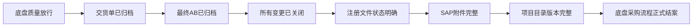

# 第十部分：质量门与快速检查

> **流程目标**：在关键承诺点前阻止不完整、不一致或未经授权的业务进入下一阶段。  
> **主要责任角色**：各质量门责任人。  
> **关键控制**：未通过即停止、修正后重新验证、例外必须书面批准。

## 45. 七个质量门总流程

## 46. 下单前快速判断流程

## 47. 订单发送前快速判断流程

## 48. 到货放行前快速判断流程

---

## 49. 关键规则速查

---

## 50. 结案状态

---

[← 返回总目录](../README.md)
