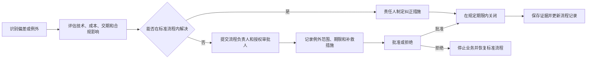

# 附录：流程治理标准

## RACI 职责矩阵

> R = 执行负责；A = 最终负责；C = 协商参与；I = 知会。

| 核心流程 | 采购 | 项目 | 技术 | 计划 | 审批人 | 物流 | 质量 | 供应商 |
|---|---:|---:|---:|---:|---:|---:|---:|---:|
| 需求完整性确认 | R | A | C | C | I | I | I | I |
| 询价与报价审核 | A/R | C | C | I | I | I | I | R |
| 最终订购资料确认 | R | A | C | C | I | I | I | R |
| SAP订单创建 | R | C | I | C | A | I | I | I |
| 正式订单发送 | R | I | I | I | A | I | I | I |
| AB审核 | A/R | C | C | C | I | I | I | R |
| 交期与变更管理 | R | A | C | C | I | I | I | R |
| 到货与系统登记 | C | I | I | I | I | A/R | C | I |
| 质量放行 | C | I | C | I | I | C | A/R | I |
| 供应商异常关闭 | A/R | C | C | I | I | C | R | R |
| 资料归档与结案 | A/R | I | I | I | I | C | C | I |

## KPI 与控制指标

| 指标 | 定义 | 建议目标 | 预警阈值 | 管理频率 |
|---|---|---:|---:|---|
| 报价按期回复率 | 按期收到报价数 / 到期询价数 | ≥95% | <90% | 月度 |
| 报价一次通过率 | 无需修订的报价数 / 已审核报价数 | ≥90% | <80% | 月度 |
| AB按期返回率 | 期限内收到AB的订单数 / 已发订单数 | ≥95% | <90% | 周度/月度 |
| AB无偏差率 | 无偏差AB数 / 已审核AB数 | ≥95% | <90% | 月度 |
| 准时交付率 | 按确认日期到货数 / 到货总数 | ≥95% | <90% | 月度 |
| 到货一次放行率 | 首检放行数 / 已检底盘数 | ≥98% | <95% | 月度 |
| 关键附件完整率 | 附件完整订单数 / 抽查订单数 | 100% | <98% | 月度 |
| 红色风险按期关闭率 | 按期关闭红色风险数 / 红色风险总数 | 100% | <95% | 周度 |

## 例外与升级机制

## 变更记录模板

| 版本 | 日期 | 变更类型 | 变更内容 | 影响流程 | 发起人 | 审核人 | 批准人 |
|---|---|---|---|---|---|---|---|
| V9.0 | YYYY-MM-DD | 兼容性修复 | 移除GitHub不稳定的Mermaid初始化和自定义样式，统一采用原生语法 | 全流程 |  |  |  |

## 发布前检查

- [ ] 所有 Mermaid 图已使用GitHub原生语法并在README中正常渲染
- [ ] 所有目录链接能够跳转到对应流程
- [ ] 流程负责人、执行人和审批人已确认
- [ ] SAP事务、字段、邮箱和文件路径仍然有效
- [ ] 所有质量门均有明确输入、判断条件和输出
- [ ] 所有例外均有书面审批与关闭证据
- [ ] 旧版本已标记为失效或归档
- [ ] 主分支中的 README 为唯一受控发布版本

[← 返回总目录](../README.md)
